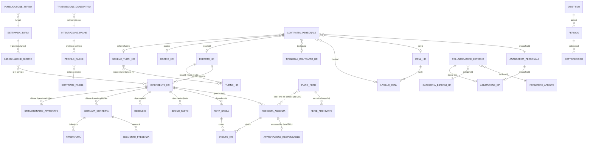

# Human Resources — modello dati, regole trasversali e API

Questo documento è la base comune di tutte le schede pagina della sezione Human Resources (HR). Descrive **entità, campi, enum, regole di business, dati demo e contratto backend** in modo che un altro team possa ricostruire frontend e backend identici senza accesso a questo repository.

> **Stato attuale (da leggere prima di tutto).** Oggi quasi tutti i dati HR sono **mock lato frontend**: store `zustand` (v5.0.12) con il middleware `persist`, salvati in `localStorage` del browser. Fanno eccezione solo:
> - l'anagrafica del personale (`/Sibylla/anagrafica-personale/GetAll|Insert|Update`, con fallback mock se il backend non risponde);
> - le presenze del giorno (`/Sibylla/operation/GetPresenzeGiornaliere`, con fallback mock);
> - l'invio del consuntivo paghe (`/Sibylla/hr/paghe/trasmetti`, «simulato» se l'endpoint non risponde);
> - l'invito all'App Op! (Op.Api, fuori dallo scope di questo documento).
>
> Tutto il resto (richieste di assenza, piani ferie, note spese, buoni pasto, cedolini, timbrature corrette, turni, configurazione HR, contratti, collaboratori esterni, obiettivi) va realizzato nel backend con le **stesse entità e le stesse regole** descritte qui. Dove questo documento propone qualcosa che nel codice non esiste (endpoint, codici d'errore, chiavi esterne), è marcato **«proposto»**.

Convenzioni:
- Date: `aaaa-mm-gg` (ISO date) salvo diversa indicazione; datetime ISO 8601 (`2026-11-05T09:30:00.000Z`). Mesi `aaaa-mm`.
- Le date «relative» del seed (es. «tra 6 giorni») sono calcolate dal **giorno in cui il seed viene generato** (primo caricamento o migrazione dello store). Il backend demo deve rigenerarle rispetto alla data del seed, altrimenti la demo invecchia.
- I nomi dei campi sono quelli del codice TypeScript (camelCase italiano); il backend deve esporre JSON con gli **stessi nomi**.
- I testi tra «…» sono riportati esattamente come nel codice (storico, toast, messaggi di validazione).

---

## Indice

1. [Diagramma delle entità](#1-diagramma-delle-entità)
2. [Entità e campi](#2-entità-e-campi)
3. [Regole di business](#3-regole-di-business)
4. [Dati demo (seed)](#4-dati-demo-seed)
5. [API REST da realizzare](#5-api-rest-da-realizzare)
6. [Persistenza attuale (localStorage) da sostituire](#6-persistenza-attuale-localstorage-da-sostituire)
7. [Permessi e ruoli](#7-permessi-e-ruoli)
8. [Incoerenze note del mock da risolvere nel backend](#8-incoerenze-note-del-mock-da-risolvere-nel-backend)
9. [File sorgente letti](#9-file-sorgente-letti)

---

## 1. Diagramma delle entità



Relazioni in parole:

- **Dipendente HR** (`DipendenteHr`, 12 persone demo) è il soggetto di richieste di assenza, note spese, buoni pasto, cedolini, presenze e turni. Il suo `reparto` è un **nome** di reparto (stringa), non un id.
- Il **responsabile di reparto** è un **nome** (stringa libera) nel record `RepartoHr.responsabile` della Configurazione HR. L'iter ferie/ROL lo cerca per nome del reparto (vedi §3.1).
- **Richiesta di assenza** → contiene l'eventuale primo livello `responsabile` (`ApprovazioneResponsabile`) e lo `storico` (`EventoHr[]`).
- **Piano ferie** non ha una FK verso le richieste: le ferie del piano sono calcolate **dal vivo** filtrando le richieste di tipo `Ferie` che si sovrappongono al periodo; alla chiusura si salva una **fotografia** (`archivio: FerieArchiviate[]`).
- **Registro presenze**: le giornate sono **generate** (mock deterministico) e incrociate con le richieste approvate; nel database si salvano solo le **correzioni manuali** (segmenti o timbrature) e lo straordinario approvato, con chiave `dipendenteId|aaaa-mm-gg`.
- **Configurazione HR** (reparti, orari, turni, schemi, tipologie, CCNL, categorie esterni, badge, integrazione paghe) è un unico documento per struttura.
- **Contratti del personale** e **abilitazione App Op!** sono legati all'**anagrafica del personale** (`anagraficaId` stringa, es. `'66'`), che oggi è un insieme di id **diverso** da quello dei 12 dipendenti HR (vedi §8).

---

## 2. Entità e campi

Legenda colonna «Obbl.»: **sì** = sempre presente; **no** = facoltativo (`?` in TypeScript).

### 2.1 Reparto (enum dei dipendenti HR)

```ts
type Reparto = 'Front office' | 'F&B' | 'Housekeeping' | 'Manutenzione' | 'Cucina' | 'Amministrazione'
REPARTI_HR = ['Front office', 'F&B', 'Housekeeping', 'Manutenzione', 'Cucina', 'Amministrazione']
```

L'ordine di `REPARTI_HR` è significativo: è l'ordine dei gruppi nei calendari e l'indice colore dell'avatar (`REP_IDX(rep) = REPARTI_HR.indexOf(rep) + 1`, quindi 1..6). È anche l'ordine in cui l'algoritmo dei turni copre i reparti.

Icone Font Awesome per reparto (`repartoIcon`, fallback `fa-user`): `Front office`/`Front Office` → `fa-bell-concierge`; `F&B` → `fa-martini-glass`; `Cucina` → `fa-kitchen-set`; `Housekeeping`/`Pulizie` → `fa-broom`; `Manutenzione` → `fa-wrench`; `Amministrazione` → `fa-briefcase`.

### 2.2 DipendenteHr

| Campo | Tipo | Obbl. | Significato |
| --- | --- | --- | --- |
| `id` | number | sì | Chiave (1..12 nella demo). |
| `nome` | string | sì | Nome. |
| `cognome` | string | sì | Cognome. |
| `reparto` | `Reparto` | sì | Uno dei 6 valori di §2.1. |
| `ferieAnnue` | number | sì | Giorni di ferie maturati nell'anno (giorni lavorativi). |
| `rolAnnui` | number | sì | Ore di ROL maturate nell'anno, in proporzione al contratto. |

Chiave: `id`. Oggi è una **costante** (`DIPENDENTI_HR`), senza CRUD: non c'è una pagina che crei o modifichi i dipendenti HR. Helper:
- `nomeDipendente(id)` = `"${nome} ${cognome}"`, oppure `'—'` se l'id non esiste.
- `repartoDipendente(id)` = reparto, oppure `''`.

**DipendentePresenze** (vista per il Registro presenze, derivata): `{ id, nome, cognome, reparto, email, telefono }` con
- `email = slug(nome) + '.' + slug(cognome) + '@hoteltutorial.it'` dove `slug` = minuscolo, accenti rimossi, solo lettere `a-z`;
- `telefono = '+39 3' + String(30 + id*3).padStart(2,'0') + ' ' + String(1000000 + id*739211).slice(0,7)`.

Costanti demo collegate:
- `SENZA_APP = [8, 11]`: dipendenti che non hanno ancora attivato l'App Op!.
- `postazioneDi(id)` = `'kiosk ingresso personale'` se `id ∈ SENZA_APP`; altrimenti `'App Op!'` se `id % 3 === 0`; altrimenti `'kiosk ingresso personale'`.

### 2.3 EventoHr (storico degli interventi)

| Campo | Tipo | Obbl. | Significato |
| --- | --- | --- | --- |
| `at` | string (ISO datetime) | sì | Quando. |
| `autore` | string | sì | Chi (vedi `autoreHr()` sotto). |
| `azione` | string | sì | Una delle azioni di §3.3. |
| `modifiche` | string[] | no | Campi cambiati, in parole (es. «Periodo: 09/11 → 15/11/2026 → 10/11 → 14/11/2026»). |
| `messaggio` | string | no | Messaggio al dipendente (motivo del rifiuto o della modifica). |

`autoreHr()` = nome del profilo collegato in `useAccessStore` (`profiles.find(id === currentProfileId).nome`), altrimenti la stringa **«Ufficio del personale»**. Nel backend: il nome dell'utente autenticato.

Lo storico è **append-only** (`conEvento` aggiunge in coda). Il primo evento visualizzato («Inviata dall'App Op!») **non è salvato**: il frontend lo ricostruisce da `createdAt` e dal nome del dipendente, tranne che per le richieste inserite dall'HR (vedi §3.3).

### 2.4 RichiestaAssenza

```ts
type TipoAssenza = 'Ferie' | 'Permesso' | 'ROL' | 'Malattia'
TIPI_ASSENZA = ['Ferie', 'Permesso', 'ROL', 'Malattia']
type StatoRichiesta = 'Al responsabile' | 'Da approvare' | 'Approvata' | 'Rifiutata'
STATI_RICHIESTA = ['Al responsabile', 'Da approvare', 'Approvata', 'Rifiutata']
TIPI_CON_RESPONSABILE = ['Ferie', 'ROL']
```

| Campo | Tipo | Obbl. | Significato / valori |
| --- | --- | --- | --- |
| `id` | string | sì | Chiave. Seed: `ra-1`…`ra-33`. Nuove: `ra-<base36 di Date.now()><4 caratteri casuali>`. |
| `dipendenteId` | number | sì | FK `DipendenteHr.id`. |
| `tipo` | `TipoAssenza` | sì | `Ferie` \| `Permesso` \| `ROL` \| `Malattia`. |
| `dal` | string `aaaa-mm-gg` | sì | Primo giorno. |
| `al` | string `aaaa-mm-gg` | sì | Ultimo giorno (≥ `dal`). |
| `note` | string | no | Note del dipendente. |
| `stato` | `StatoRichiesta` | sì | `Al responsabile` \| `Da approvare` \| `Approvata` \| `Rifiutata`. |
| `motivo` | string | no | Motivo del rifiuto; valorizzato **solo** se `stato === 'Rifiutata'` (negli altri stati viene azzerato). |
| `ore` | number | no | Ore richieste (ROL e permessi a ore, solo se `dal === al`). Assente = giornata intera: 8 h per giorno lavorativo. Valori validi da 0,5 a 8; il valore 8 non si salva (equivale a giornata intera → `undefined`). |
| `createdAt` | string ISO datetime | sì | Data della richiesta. |
| `storico` | `EventoHr[]` | no | Interventi. |
| `responsabile` | `ApprovazioneResponsabile` | no | Primo livello dell'iter ferie/ROL; **assente** se la richiesta va direttamente all'HR. |

**ApprovazioneResponsabile**

| Campo | Tipo | Obbl. | Significato / valori |
| --- | --- | --- | --- |
| `nome` | string | sì | Nome del responsabile di reparto (da `RepartoHr.responsabile`). |
| `esito` | `'In attesa' \| 'Approvata' \| 'Rifiutata'` | sì | Decisione del responsabile. |
| `at` | string ISO datetime | no | Quando ha deciso. |
| `motivo` | string | no | Motivo, solo se `Rifiutata`. |
| `sollecitatoAt` | string ISO datetime | no | Ultimo sollecito inviato dall'HR. |

Stato iniziale di una richiesta creata dal dipendente: vedi `iterIniziale` (§3.1).

### 2.5 NotaSpesa

```ts
type CategoriaSpesa = 'Treno' | 'Bus' | 'Aereo' | 'Parcheggio' | 'Taxi' | 'Pasti' | 'Varie'
CATEGORIE_SPESA = ['Treno', 'Bus', 'Aereo', 'Parcheggio', 'Taxi', 'Pasti', 'Varie']
TRASPORTI = ['Treno', 'Bus', 'Aereo', 'Parcheggio', 'Taxi']
VITTO_ALTRO = ['Pasti', 'Varie']
type StatoSpesa = 'Da approvare' | 'Approvata' | 'Rifiutata' | 'Rimborsata'
STATI_SPESA = ['Da approvare', 'Approvata', 'Rifiutata', 'Rimborsata']
VALORE_BUONO = 8   // € per buono pasto giornaliero (esente fino a 8 € se elettronico)
```

| Campo | Tipo | Obbl. | Significato |
| --- | --- | --- | --- |
| `id` | string | sì | Seed `ns-1`…; nuove `ns-<base36><rand>`. |
| `dipendenteId` | number | sì | FK dipendente. |
| `data` | `aaaa-mm-gg` | sì | Giorno della spesa. |
| `categoria` | `CategoriaSpesa` | sì | Voce. |
| `descrizione` | string | sì | Se vuota in modifica diventa il nome della voce. |
| `importo` | number | sì | Euro, > 0, arrotondato ai centesimi (`Math.round(val*100)/100`). |
| `giustificativo` | string | no | Nome del file PDF della ricevuta (max 3 MB, solo PDF). |
| `stato` | `StatoSpesa` | sì | Nuova = `Da approvare`. |
| `motivo` | string | no | Solo se `Rifiutata`. |
| `storico` | `EventoHr[]` | no | Interventi. |

### 2.6 BuonoPasto

Oggi è una lista di chiavi stringa `buoniPasto: string[]` con formato **`dipendenteId|aaaa-mm-gg`** (`chiaveBuono(id, iso)`). La presenza della chiave = buono pasto assegnato quel giorno (valore fisso `VALORE_BUONO = 8` €). Backend proposto: tabella `(dipendenteId, data)` con chiave composta.

### 2.7 Cedolino

```ts
type StatoCedolino = 'Bozza' | 'Pubblicato'
```

| Campo | Tipo | Obbl. | Significato |
| --- | --- | --- | --- |
| `id` | string | sì | `ced-<aaaa-mm>-<dipendenteId>` (unico per dipendente e mese). |
| `dipendenteId` | number | sì | FK. |
| `mese` | `aaaa-mm` | sì | Mese di competenza. |
| `lordo` | number | sì | Euro. |
| `netto` | number | sì | Euro. Mock: `Math.round(lordo * 0.74 * 100) / 100`. |
| `file` | string | sì | Nome del PDF: `cedolino_<aaaa-mm>_<cognome minuscolo>.pdf`. |
| `stato` | `StatoCedolino` | sì | Caricato = `Bozza`. |
| `visto` | boolean | sì | Il dipendente l'ha aperto dalla sua area (App Op!). |
| `pubblicatoAt` | string | no | Data di pubblicazione (`aaaa-mm-gg`). |

Vincolo: un solo cedolino per `(dipendenteId, mese)`.

### 2.8 Registro presenze

```ts
type SegmentoTipo = 'presente' | 'assenza' | 'permesso' | 'ferie' | 'pausa'
type VersoTimbratura = 'entrata' | 'uscita'
GIORNO_MIN = 1440
ORE_ORDINARIE = 8
SOGLIA_STRAORDINARIO = 30   // minuti
```

**SegmentoPresenza**

| Campo | Tipo | Obbl. | Significato |
| --- | --- | --- | --- |
| `tipo` | `SegmentoTipo` | sì | `presente` \| `assenza` \| `permesso` \| `ferie` \| `pausa`. |
| `start_min` | number | sì | Minuto del giorno 0..1440. |
| `end_min` | number | sì | Minuto del giorno 0..1440. |
| `note` | string | no | Es. `'Riposo'`, `'Malattia'`, `'ROL'`, `'Permesso'`, `'Ferie'` o note della richiesta. La classificazione legge queste note (vedi §3.9). |

**Timbratura**

| Campo | Tipo | Obbl. | Significato |
| --- | --- | --- | --- |
| `id` | string | sì | Generate: `<chiave>-e<i>` / `<chiave>-u<i>`. |
| `min` | number | sì | Minuto del giorno. |
| `verso` | `VersoTimbratura` | sì | `entrata` \| `uscita`. |
| `postazione` | string | sì | Es. `'kiosk ingresso personale'`, `'App Op!'`, `'principale'`. |
| `note` | string | no | |

**Stato salvato del registro** (solo correzioni dell'HR):

| Campo | Tipo | Significato |
| --- | --- | --- |
| `segmenti` | `Record<chiave, SegmentoPresenza[]>` | Giornate corrette a mano (tipo di giornata o orario). `[]` = giornata svuotata. |
| `timbrature` | `Record<chiave, Timbratura[]>` | Timbrature corrette a mano: quando ci sono, la presenza si ricalcola da loro. |
| `straordinarioApprovato` | `Record<chiave, number>` | Minuti di straordinario approvati dal datore di lavoro per giornata (pagina Cedolini, vista dettagliata). |
| `timbraturaConNomeFino` | `aaaa-mm-gg` | Fino a questa data la timbratura dall'app scrivendo nome e cognome è consentita. Default: oggi + 30 giorni. |
| `trasmissioni` | `TrasmissioneConsuntivo[]` | Storico degli invii al software paghe, dal più recente. |

`chiave = chiaveGiorno(dipId, iso) = "${dipId}|${iso}"`.

**GiornataRegistro** (risultato calcolato, vedi §3.8): `{ segmenti, timbrature, modificato: boolean, inServizio?: boolean }`.

**GiornoRegistro** (classificazione, §3.9): `{ codice: CodiceGiorno, descrizione, ingresso?, uscita?, lavorati, ordinari, straordinari, permesso, tipoPermesso?: 'ROL' | 'Permesso' }` (tutti i tempi in minuti).

```ts
type CodiceGiorno = 'ORD' | 'STR' | 'O+P' | 'RIP' | 'FER' | 'ROL' | 'PER' | 'MAL' | 'ASS' | 'ANO' | 'VUO'
```

Legenda (`LEGENDA`, in quest'ordine): ORD «Ordinarie», STR «Straordinario», RIP «Riposo», FER «Ferie», ROL «ROL», PER «Permesso», MAL «Malattia», ASS «Assente», ANO «Timbratura anomala».

Sigla nella cella Tipo (`SIGLA`): ORD→`ORD`, STR→`O+S`, O+P→`O+P`, RIP→`RIP`, FER→`FER`, ROL→`ROL`, PER→`PER`, MAL→`MAL`, ASS→`ASS`, ANO→`ANO`, VUO→`''`.

**GiornoMese**: `{ iso, n (1..31), dow (0=dom), oggi, futuro, festivo (domenica o festività), festivita: string|null, g: GiornoRegistro, modificato }`.

**TotaliMese**: `{ ordinari, straordinari, ferie, rol, permessi, malattia, assenze, anomalie, modificati, ore: Record<VoceOre, { ore, gg }> }` con `VOCI_ORE = ['Ordinarie', 'Straordinario', 'Festive', 'Permessi', 'Infortunio', 'Malattia', 'Ferie', 'Trasferta']`.

**TrasmissioneConsuntivo**

| Campo | Tipo | Obbl. | Significato |
| --- | --- | --- | --- |
| `id` | string | sì | `tc<Date.now()>`. |
| `mese` | `aaaa-mm` | sì | Mese di competenza. |
| `software` | string | sì | Nome leggibile, es. «TeamSystem Paghe / HR Lynfa Studio» (`nomeSoftwarePaghe` = `${produttore} ${nome}`). |
| `at` | ISO datetime | sì | Quando. |
| `autore` | string | sì | `autoreHr()`. |
| `dipendenti` | number | sì | Numero di dipendenti trasmessi. |
| `oreOrdinarie` | number | sì | Arrotondato a 1 decimale. |
| `oreStraordinario` | number | sì | Arrotondato a 1 decimale. |
| `giorniFerie` | number | sì | |
| `orePermessi` | number | sì | Arrotondato a 1 decimale. |
| `giorniMalattia` | number | sì | |
| `anomalie` | number | sì | Timbrature anomale al momento dell'invio. |
| `note` | string | no | Note dell'HR. |
| `esito` | `'inviato' \| 'simulato'` | no | «simulato» finché il connettore non è attivo. |
| `protocollo` | string | no | Dal backend. |
| `file` | `{ nome: string; record: number }` | no | Es. `{ nome: 'RILPRE', record: 12 }`. |

### 2.9 Piano ferie

```ts
type StatoPiano = 'Aperto' | 'Archiviato'
REGOLE_DEFAULT = { maxGiorniConsecutivi: 10, presenzaMinimaReparto: 50, entroResidui: true, negativoMax: 2 }
```

**RegolePiano**

| Campo | Tipo | Obbl. | Significato / validazione (modale) |
| --- | --- | --- | --- |
| `maxGiorniConsecutivi` | number | no | Massimo di giorni **di calendario** consecutivi di ferie per persona (richieste attaccate comprese). Assente = nessun limite. Intero ≥ 1, altrimenti «Un numero intero di giorni, almeno 1». |
| `presenzaMinimaReparto` | number | no | % minima del reparto che deve restare in servizio ogni giorno. Assente = nessun controllo. Intero 0..100, altrimenti «Una percentuale da 0 a 100». |
| `entroResidui` | boolean | sì | Le ferie non possono superare i giorni residui. |
| `negativoMax` | number | sì | Giorni oltre il residuo concedibili con autorizzazione esplicita dell'HR; 0 = mai. Con `entroResidui` intero ≥ 0, altrimenti «Un numero intero di giorni, 0 se mai». Se `entroResidui` è falso si salva 0. |

**PianoFerie**

| Campo | Tipo | Obbl. | Significato |
| --- | --- | --- | --- |
| `id` | string | sì | Seed `pf-natale`, `pf-estate`; nuovi `pf-<base36><rand>`. |
| `nome` | string | sì | Obbligatorio: «Dai un nome al piano, ad esempio "Natale 2026"». |
| `dal`, `al` | `aaaa-mm-gg` | sì | Periodo. «Indica il periodo del piano»; se `al < dal` «La data di fine precede quella di inizio». |
| `scadenzaRichieste` | `aaaa-mm-gg` | no | Termine per chiedere le ferie dall'App Op!. Se `> dal`: «Il termine per le richieste deve cadere prima dell'inizio del piano». |
| `regole` | `RegolePiano` | sì | |
| `note` | string | no | Avviso ai dipendenti mostrato nell'App Op!. |
| `stato` | `StatoPiano` | sì | Nuovo = `Aperto`. |
| `createdAt` | ISO datetime | sì | |
| `creatoDa` | string | sì | `autoreHr()`. |
| `archiviatoAt` | ISO datetime | no | |
| `archiviatoDa` | string | no | |
| `archivio` | `FerieArchiviate[]` | no | Fotografia alla chiusura. |

**FerieArchiviate**: `{ richiestaId, dipendenteId, dal, al (già tagliate ai confini del piano), stato: StatoRichiesta, giorni (giorni lavorativi del tratto tagliato) }`.

### 2.10 Turni del personale

**ContrattoTurno** (mock dei giorni di servizio a settimana, `CONTRATTI_TURNO[id]`, fallback `{ tipo: 'Full time', giorni: 5 }`): `{ tipo: string, giorni: number }` — valori in §4.6.

```ts
type Assegnazioni = Record<string /* aaaa-mm-gg */, number[] /* id dipendenti in servizio */>
type OrigineTurno = 'manuale' | 'sibylla'
type LivelloCarico = 'basso' | 'medio' | 'alto'
type CadenzaTurni = 'giornaliera' | 'settimanale' | 'bisettimanale' | 'mensile'
```

**SettimanaTurni** (chiave = lunedì `aaaa-mm-gg`): `{ origine: OrigineTurno, modificata?: boolean (modificata a mano dopo il suggerimento), salvataAt?: ISO, pubblicataAt?: ISO }`.

**PubblicazioneTurno**: `{ id: 'pt-<base36>-<rand>', lunedi, at: ISO, assegnazioni: Assegnazioni (fotografia dei 7 giorni), destinatari: numero di dipendenti distinti nella fotografia }`.

**SuggerimentoTurni** (calcolato, §3.13): `{ lunedi, assegnazioni, occupazioneMedia, picco: { iso, occ }, turni, fabbisognoTot, assenzeConsiderate: { id, tipo, inAttesa, giorni }[], scoperture: { iso, reparto, mancano }[], note: string[] }`.

**AssenzaGiorno** (calcolata): `{ tipo: TipoAssenza, inAttesa: boolean, ore?: number }`.

Stato salvato: `assegnazioni` (tutte le date), `settimane: Record<lunedi, SettimanaTurni>`, `pubblicazioni: PubblicazioneTurno[]` (dalla più recente), `focusLunedi: string | null` (settimana da aprire quando si arriva da una notifica; stato UI, non serve nel backend).

Cadenze dei suggerimenti (`CADENZE_TURNI`): `giornaliera` «Ogni giorno», `settimanale` «Ogni settimana», `bisettimanale` «Ogni due settimane», `mensile` «Ogni mese». Preferenza in `useNotifPrefsStore`: `turniPersonale: boolean` (default `true`), `turniCadenza` (default `'settimanale'`).

### 2.11 Configurazione HR (`HrConfigData`, un documento per struttura)

```ts
GIORNI_SETTIMANA = ['Lun', 'Mar', 'Mer', 'Gio', 'Ven', 'Sab', 'Dom']
RIPOSO = 'R'
```

**RepartoHr**

| Campo | Tipo | Obbl. | Significato |
| --- | --- | --- | --- |
| `id` | string | sì | Es. `rep-fo`. |
| `nome` | string | sì | Deve coincidere con `DipendenteHr.reparto` per collegare i dipendenti. |
| `codice` | string | sì | Es. `FO`. |
| `responsabile` | string | sì | Nome del responsabile di reparto (può essere `''` = nessuno). |
| `centroCosto` | string | sì | Es. `CDC-01 Ricevimento`. |
| `colore` | number | sì | Indice 1..8 della palette `--chart-*`. |
| `repartoOp` | `RepartoOp` | no | Reparto dell'App Op! in cui entra di default chi appartiene al reparto. |
| `attivo` | boolean | sì | Solo i reparti attivi valgono per l'iter. |
| `descrizione` | string | no | |

`RepartoOp = 'pulizie' | 'manutenzione' | 'magazzino' | 'frontOffice' | 'foodBeverage' | 'risorseUmane' | 'businessIntelligence' | 'purchasing'`.

**OrarioHr**

```ts
type RegimeOrario = 'full-time' | 'part-time-orizzontale' | 'part-time-verticale' | 'part-time-misto'
REGIMI_ORARIO = [
  { value: 'full-time', label: 'Full time' },
  { value: 'part-time-orizzontale', label: 'Part time orizzontale' },
  { value: 'part-time-verticale', label: 'Part time verticale' },
  { value: 'part-time-misto', label: 'Part time misto' },
]
```

| Campo | Tipo | Obbl. | Significato |
| --- | --- | --- | --- |
| `id`, `nome` | string | sì | |
| `regime` | `RegimeOrario` | sì | |
| `aTurni` | boolean | sì | true = gli orari giornalieri li decide la turnistica: conta solo il monte ore. |
| `oreSettimanali` | number | sì | Usato con `aTurni`. |
| `giorniSettimana` | number | sì | Usato con `aTurni`. |
| `giorni` | `FasciaGiorno[7]` | sì | Lun→Dom, usato senza `aTurni`. |
| `flessibilitaMin` | number | sì | Tolleranza entrata/uscita (minuti). |

`FasciaGiorno = { attivo: boolean, fasce: { inizio: 'hh:mm', fine: 'hh:mm' }[], pausaMin: number }` (più fasce = giornata spezzata; pausa non retribuita dentro le fasce). Formato vecchio `{ attivo, entrata, uscita, pausaMin }` normalizzato da `normalizzaGiorno`.

**TurnoHr**: `{ id, sigla, nome, inizio, fine, inizio2?, fine2? (turno spezzato), pausaMin, colore (1..8), reparti: string[] (id reparto; vuoto = tutti) }`.

**SchemaTurniHr**: `{ id, nome, descrizione, sequenza: string[] (id turno oppure 'R') }`.

**TipologiaContrattoHr**: `{ id, nome, codice (codice UniLav), conScadenza: boolean, durataMaxMesi?: number, periodoProva: boolean, attiva: boolean }`.

**CcnlHr**

```ts
type CategoriaLivello = 'Dirigente' | 'Quadro' | 'Impiegato' | 'Operaio' | 'Apprendista'
type MaturazioneTipo = 'mensile' | 'annuale' | 'oraria'
MATURAZIONI = [
  { value: 'mensile', label: 'Ratei mensili (1/12)' },
  { value: 'annuale', label: 'Annuale, a inizio anno' },
  { value: 'oraria',  label: 'Per ora lavorata' },
]
```

| Campo | Tipo | Significato |
| --- | --- | --- |
| `id`, `nome`, `codiceCnel`, `settore` | string | |
| `validoDal`, `validoAl` | `aaaa-mm-gg` | |
| `oreSettimanaliPieno` | number | Orario pieno (per la % di part time). |
| `mensilita` | number | |
| `ferieGiorni` | number | |
| `ferieSettimanaGiorni` | `5 \| 6` | Settimana su cui si contano le ferie. |
| `ferieMinimeAnnoSettimane` | number | Settimane da godere nell'anno di maturazione. |
| `ferieScadenzaMesi` | number | Residue da godere entro N mesi dalla fine dell'anno. |
| `rolOre`, `exFestivitaOre` | number | |
| `permessiScadenzaMesi` | number | ROL non goduti liquidati entro N mesi. |
| `maturazione` | `MaturazioneTipo` | |
| `frazioneMeseGiorni` | number | Frazione di mese ≥ N giorni = mese intero. |
| `riproporzionaPartTime` | boolean | |
| `maturaInAssenzeRetribuite` | boolean | |
| `scattiNumero`, `scattiCadenzaAnni` | number | |
| `maggStraordinario`, `maggNotturno`, `maggFestivo` | number | Maggiorazioni %. |
| `comportoGiorni` | number | |
| `fondoSanitario`, `previdenzaComplementare`, `enteBilaterale` | string | |
| `livelli` | `LivelloCcnl[]` | |

**LivelloCcnl**: `{ id, codice, descrizione, categoria: CategoriaLivello, minimoMensile (€ lordi), scattoImporto (€), provaGiorni (giorni di lavoro effettivo), preavvisoGiorni (giorni di calendario) }`.

**CategoriaEsterniHr**: `{ id, nome, repartiOp: RepartoOp[], documenti: string[], durataMaxMesi, colore, attiva }`. Documenti ammessi (`DOCUMENTI_ESTERNI`): «Contratto d’appalto», «DURC», «Formazione sicurezza», «Documento d’identità», «Attestato HACCP», «Idoneità sanitaria» (con l'apostrofo tipografico `’`). Il DUVRI **non** è un documento del singolo addetto: è dell'appalto.

**BadgeConfigHr** (default `BADGE_DEFAULT`):

| Campo | Tipo | Default |
| --- | --- | --- |
| `intestazione` | string | `''` (= nome della struttura corrente) |
| `colore` | number | `1` |
| `orientamento` | `'orizzontale' \| 'verticale'` | `'orizzontale'` |
| `formatoStampa` | `'cr80' \| 'a4'` | `'a4'` (cr80 = una tessera per pagina; a4 = foglio con più tessere) |
| `mostraNascita`, `mostraCategoria`, `mostraValidita`, `mostraPartitaIva`, `mostraQr`, `retro` | boolean | tutti `true` |
| `dicitura` | string | «Tessera di riconoscimento — art. 26 c. 8 D.Lgs. 81/2008 e art. 5 L. 136/2010» |
| `testoRetro` | string | «Il titolare è autorizzato ad accedere alla struttura solo nel periodo indicato. In caso di smarrimento avvisare il ricevimento. La tessera va esposta in modo visibile durante il servizio.» |

**IntegrazionePagheHr**

| Campo | Tipo | Significato |
| --- | --- | --- |
| `inUso` | `SoftwarePagheId \| null` | Software usato da Trasmetti consuntivo; null = nessuno. |
| `profili` | `Partial<Record<SoftwarePagheId, ProfiloPaghe>>` | Un profilo per software configurato. |
| `invioAutomatico` | boolean | |
| `giornoInvio` | number | Giorno del mese successivo dell'invio automatico. |
| `oraInvio` | `hh:mm` | |
| `soloStraordinarioApprovato` | boolean | Nel consuntivo conta solo lo straordinario approvato in Cedolini. |
| `bloccaConAnomalie` | boolean | Con timbrature anomale l'invio è bloccato. |
| `notificaEsito` | boolean | Avviso all'ufficio del personale a invio riuscito o fallito. |

**ProfiloPaghe**: `{ canale: 'api' | 'sftp' | 'email', valori: Record<chiaveCampo, string>, formato: string, chiaveDipendente: string, voci: Record<voce, codice>, ultimoTest?: { at, ok, messaggio }, codiciDipendente?: Record<dipendenteId, string>, sommaOrdinario?: string[] }`.
- `codiceDipendentePaghe(p, id)` = `p.codiciDipendente[id]` oppure `String(1000 + id)` finché l'HR non lo imposta.
- `profiloPagheVuoto(id)` = `{ canale: sw.canali[0], valori: {}, formato: sw.formati[0], chiaveDipendente: sw.chiaveDipendente[0], voci: { ...sw.voci } }`.

**Catalogo software paghe** (`SOFTWARE_PAGHE`, statico, fa parte del prodotto — il backend può tenerlo come costante):

| id | produttore · nome | sigla | canali | formati | chiaveDipendente |
| --- | --- | --- | --- | --- | --- |
| `zucchetti` | Zucchetti · Paghe Project / Infinity HR | ZU | api, sftp, email | «Tracciato presenze Zucchetti (TXT a campi fissi)», «Infinity HR – import giustificativi (CSV)» | «Matricola Zucchetti», «Codice fiscale» |
| `teamsystem` | TeamSystem · Paghe / HR Lynfa Studio | TS | api, sftp, email | «RILPRE – tracciato standard (record fisso 1707)», «RILPRE – procedura RP / Teamtime (record fisso 1707)» | «Codice dipendente TeamSystem» |
| `inaz` | Inaz · Paghe Inaz / HRM | IN | api, sftp | «Inaz presenze (XML)», «Inaz giustificativi (CSV)» | «Matricola Inaz», «Codice fiscale» |
| `sistemi` | Sistemi · Job Paghe | SI | sftp, email | «Tracciato presenze Job (TXT)», «Import presenze Job (CSV)» | «Matricola Job», «Codice fiscale» |
| `ranocchi` | Ranocchi · Paghe Web | RA | api, email | «Paghe Web – import presenze (CSV)» | «Codice dipendente Paghe Web», «Codice fiscale» |
| `adp` | ADP · Workforce Now / GlobalView | AD | api, sftp | «ADP Time & Attendance (CSV)», «ADP pay data input (XML)» | «Associate ID ADP», «Codice fiscale» |

Descrizioni:
- zucchetti: «Rilevazione presenze verso Paghe Project o Infinity HR: tracciato a campi fissi o servizio web di Infinity.»
- teamsystem: «Presenze del mese nel tracciato RILPRE (record fisso da 1707 caratteri per dipendente), importato dalla procedura paghe TeamSystem.»
- inaz: «Giustificativi e ore verso le paghe Inaz tramite web service o tracciato XML.»
- sistemi: «Tracciato presenze per Job Paghe depositato su SFTP o inviato allo studio.»
- ranocchi: «Presenze verso Paghe Web via API o file per lo studio.»
- adp: «Time & Attendance verso ADP con API OAuth e certificato client, oppure file su SFTP.»

Codici voce proposti (`voci`), nell'ordine Ordinarie / Straordinario / Festive / Permessi / Ferie / Malattia / Infortunio / Trasferta / Assenza:
- zucchetti: `0001` `0101` `0110` `0310` `0300` `0400` `0410` `0500` `0900`
- teamsystem: `''` `ST` `LF` `PR` `FE` `MA` `IN` `TR` `AI` (codici di 2 caratteri, validi in entrambe le varianti TB1103)
- inaz: `HO` `S1` `FE` `PR` `FR` `MA` `IN` `TR` `AI`
- sistemi: `01` `20` `30` `41` `40` `50` `55` `60` `90`
- ranocchi: `OR` `ST` `FS` `PE` `FE` `MA` `IF` `TR` `AN`
- adp: `REG` `OT1` `HOL` `PTO` `VAC` `SCK` `INJ` `TRV` `UNA`

Campi del collegamento (`campi`, `key` / label / tipo / placeholder / canali / obbligatorio / hint):
- **Comuni SFTP** (canale `sftp`): `sftpHost` «Host SFTP» placeholder `sftp.studio.it` obbl.; `sftpPorta` «Porta» `22`; `sftpUtente` «Utente SFTP» obbl.; `sftpPassword` «Password o chiave» password obbl.; `sftpCartella` «Cartella di destinazione» `/in/presenze`.
- **Comuni email** (canale `email`): `studio` «Studio del consulente» `Studio Rossi consulenti del lavoro`; `emailConsulente` «Email del consulente» email `paghe@studio.it` obbl.; `emailCc` «In copia» email `amministrazione@hotel.it`.
- zucchetti: `codiceDitta` «Codice ditta» `000123` obbl. hint «Codice della ditta in Paghe Project.»; `codiceAzienda` «Codice azienda» `0001`; `tenant` «URL del tenant Infinity» url `https://hotelnoto.infinity.zucchetti.it` [api] obbl.; `clientId` «Client ID» [api] obbl.; `clientSecret` «Client secret» password [api] obbl.; + SFTP + email.
- teamsystem: `codiceAzienda` «Codice azienda» `0042` obbl. hint «Fino a 4 cifre: posizioni 1–4 del RILPRE.»; `codiceFiliale` «Codice filiale» `01` hint «Fino a 3 cifre: con 3 cifre va negli ultimi caratteri del nome (pos. 81).»; `codiceStudio` «Codice studio» `ST0042` hint «Lo studio che elabora le paghe.»; `ambiente` «Ambiente» select [`Produzione`, `Test`] [api]; `apiKey` «API key Digital Hub» password [api] obbl.; + SFTP + email.
- inaz: `codiceAzienda` «Codice azienda» `A001` obbl.; `codiceFiliale` «Codice filiale» `01`; `wsUrl` «URL del web service» url `https://ws.inaz.it/presenze` [api] obbl.; `wsUtente` «Utente web service» [api] obbl.; `wsPassword` «Password web service» password [api] obbl.; + SFTP.
- sistemi: `codiceAzienda` «Codice azienda Job» `00042` obbl.; `codiceStudio` «Codice studio» `S12`; + SFTP + email.
- ranocchi: `codiceStudio` «Codice studio» obbl.; `codiceDitta` «Codice ditta» obbl.; `apiToken` «Token API» password [api] obbl.; + email.
- adp: `companyCode` «Company code» `HN01` obbl.; `clientId` «Client ID OAuth» [api] obbl.; `clientSecret` «Client secret» password [api] obbl.; `certificato` «Certificato client (alias)» `adp-hotelnoto-2026` [api] hint «Il certificato si carica dal portale ADP e resta sul server di Sibylla.»; + SFTP.

Canali (`CANALI_PAGHE`): `api` «Collegamento diretto (API)» `fa-plug` «Il consuntivo arriva nel software paghe senza passaggi manuali.»; `sftp` «File su SFTP» `fa-server` «Sibylla deposita il tracciato nella cartella del consulente.»; `email` «Email al consulente» `fa-envelope` «Il tracciato parte in allegato all’indirizzo del consulente.».

Voci del consuntivo (`VOCI_CONSUNTIVO`): Ordinarie «Ore ordinarie lavorate»; Straordinario «Straordinario oltre l'orario»; Festive «Ore lavorate di domenica e nei festivi»; Permessi «Permessi e ROL a ore»; Ferie «Giornate di ferie»; Malattia «Giornate di malattia (con PUC)»; Infortunio «Giornate di infortunio»; Trasferta «Giornate in trasferta»; Assenza «Assenza non giustificata».

**Segreti**: le chiavi che soddisfano `/password|secret|token|apikey|chiave/i` non devono mai uscire dal browser (`parametriPubblici`). Nel backend vanno salvate cifrate e restituite **mascherate** (es. `'••••••••'`, come nel seed).

### 2.12 Contratto del personale (`ContrattoPersonale`)

| Campo | Tipo | Obbl. | Significato |
| --- | --- | --- | --- |
| `id` | string | sì | Seed `ctr-seed-<anag>-<n>`; nuovi `ctr-<performance.now()>-<rand>`. |
| `anagraficaId` | string | sì | FK anagrafica personale (es. `'66'`). |
| `nomeImpiegato` | string | sì | |
| `ruolo` | string | sì | Es. «Direttore di struttura». |
| `livello` | string | no | Codice livello, es. `Q.A`. |
| `tipologia` | string | sì | Nome tipologia, es. «Tempo indeterminato». |
| `ral` | string | sì | Retribuzione annua lorda come **testo**, es. `'52.000'`. |
| `decorrenza` | `aaaa-mm-gg` | no | Decorrenza della (variazione di) contratto. |
| `note` | string | no | |
| `ccnlId`, `ccnl` | string | no | Id e **etichetta al momento della firma**. |
| `livelloId`, `tipologiaId`, `repartoId`, `reparto`, `orarioId`, `schemaTurniId` | string | no | Inquadramento dal Configuratore HR. |
| `partTimePerc` | number | no | 100 = full time. |
| `scadenza` | `aaaa-mm-gg` | no | Fine rapporto per tipologie con scadenza. |
| `provaGiorni` | number | no | |
| `ferieGiorni`, `rolOre`, `exFestivitaOre` | number | no | Spettanze annue fissate alla firma. |
| `pdfName`, `pdfDataUrl` | string | no | PDF del contratto (oggi data URL; nel backend file su storage). |
| `createdAt` | ISO datetime | sì | |

Ordine: `sortDesc` per `(decorrenza ?? createdAt)` decrescente; il primo è il **contratto vigente** (`ultimoContratto`). Ogni variazione è un **nuovo record** (storico).

### 2.13 Abilitazione App Op! (`AbilitazioneOp`, chiave = `anagraficaId` o `est-<idCollaboratore>`)

| Campo | Tipo | Significato |
| --- | --- | --- |
| `abilitato` | boolean | Check di abilitazione all'App Op!. |
| `emailAziendale` | string | Dove arriva il token d'invito. Validazione `/^[^\s@]+@[^\s@]+\.[^\s@]{2,}$/`. |
| `livello` | `'amministratore' \| 'responsabile' \| 'impiegato'` | Grado nell'app. |
| `reparti` | `RepartoOp[]` | Almeno uno per invitare. |
| `responsabile` | boolean | Responsabile dei suoi reparti nell'App Op!. |
| `hr` | boolean | Permessi HR nell'App Op!. |
| `opId` | number | Utenza creata nell'App Op! (dopo il primo invito). |
| `ultimoInvito` | `{ emailMascherata, scadeIl, inviatoIl }` | |

Default `abilitazioneVuota()` = `{ abilitato: false, emailAziendale: '', livello: 'impiegato', reparti: [], responsabile: false, hr: false }`.

Errori dell'invito (testi esatti): «Inserisci un’email aziendale valida: è lì che arriva il token di invito.»; «Nome e cognome del dipendente sono obbligatori.»; «Scegli almeno un reparto dell’App Op!.»; «L’App Op! non ha restituito il codice di invito.».

### 2.14 Anagrafica del personale (già con backend)

Endpoint esistenti: `POST /Sibylla/anagrafica-personale/GetAll` (body `{}`), `POST /Sibylla/anagrafica-personale/Insert`, `POST /Sibylla/anagrafica-personale/Update`.

Lettura (`PersonaleItem`): `{ id, matricola, nome, cognome, telefono, email, contatto_emergenza, nato_il ('gg/mm/aaaa'), codice_fiscale, indirizzo, cap, provincia, nazione, documenti?: { identita, codiceFiscale, contratto, privacy, sicurezza, altri: string[] } }`.

Scrittura (form di Crea anagrafica): `{ nome, cognome, data_nascita, sesso, codice_fiscale, email, email_aziendale, telefono, contatto_emergenza, indirizzo, indirizzo2, cap, provincia, nazionalita (default 'ITALIA'), strutture, repartoId, orarioId, schemaTurniId }`. Validazione: «Nome e cognome sono obbligatori». Se la chiamata fallisce il frontend prosegue comunque (mock). L'inquadramento (`repartoId`, `orarioId`, `schemaTurniId`) viene scritto anche sul **contratto vigente**.

Documenti obbligatori del fascicolo: `identita` «Documento d'identità», `codiceFiscale` «Codice fiscale / Tessera sanitaria», `privacy` «Informativa privacy», `sicurezza` «Formazione sicurezza» + «Contratto di lavoro» (valutato dallo storico contratti, non dai documenti).

### 2.15 Collaboratore esterno (`CollaboratoreEsterno`)

| Campo | Tipo | Obbl. | Significato |
| --- | --- | --- | --- |
| `id` | string | sì | Seed `ce-1..3`; nuovi `ce-<base36>-<rand>`. |
| `nome`, `cognome`, `email`, `telefono`, `codiceFiscale` | string | sì | |
| `dataNascita` | `aaaa-mm-gg` | no | |
| `dataAssunzione` | `aaaa-mm-gg` | no | Presso l'impresa appaltatrice (obbligatoria sul badge, L. 136/2010). |
| `foto` | string (data URL) | no | Foto tessera. |
| `numeroBadge` | string | no | `EST-0001`…; se assente alla creazione: `EST-` + (massimo numerico esistente + 1) a 4 cifre. |
| `fornitoreId` | string | sì | FK fornitore Purchasing con `appalto: true`. |
| `categoriaId` | string | sì | FK `CategoriaEsterniHr`. |
| `strutture` | string[] | sì | Vuoto = tutte. |
| `autorizzatoDal`, `autorizzatoAl` | `aaaa-mm-gg` | sì | Periodo di autorizzazione (oltre, l'accesso all'App Op! si spegne). |
| `documenti` | `Record<nomeDocumento, { file?, dataUrl?, scadenza? }>` | sì | |
| `note` | string | sì | |
| `createdAt` | ISO | sì | |

`StatoAutorizzazione = 'attiva' | 'in-scadenza' | 'scaduta' | 'futura'`, calcolato:
```
if (autorizzatoDal && autorizzatoDal > oggi) 'futura'
else if (autorizzatoAl && autorizzatoAl < oggi) 'scaduta'
else if (autorizzatoAl && autorizzatoAl <= oggi + 30 giorni) 'in-scadenza'
else 'attiva'
```
Etichette: attiva «Autorizzato», in-scadenza «In scadenza», scaduta «Scaduto», futura «Non ancora attivo».

`documentiMancanti(c, categoria)` = documenti richiesti dalla categoria con `!file` oppure con `scadenza` valorizzata e `< oggi`.

### 2.16 Azienda in appalto (fornitore Purchasing con `appalto: true`)

Il fornitore (`Fornitore`) ha `appalto?: boolean` e `datiAppalto?: DatiAppalto`:
`{ ragioneSociale, partitaIva, codiceFiscale, sedeLegale, oggetto, referente, referenteTelefono, referenteEmail, contrattoNumero, contrattoData, contrattoScadenza, durcScadenza, posizioneInps, posizioneInail, subappalto: boolean, subappaltoAutorizzazione, duvri?, idoneita?, informativaRischi?, fisco?, privacy? }` con
- `DuvriAppalto = { dovuto, allegato?: { nome, dataUrl? }, dataRedazione, dataSottoscrizione, revisione, prossimoAggiornamento, costiSicurezza (€), esenzione: 'intellettuale' | 'forniture' | 'cinque-uomini-giorno' | '', incaricatoCoordinamento }`;
- `IdoneitaAppalto = { visura?, visuraData, autocertificazione?, autocertificazioneData }`;
- `InformativaRischiAppalto = { allegato?, dataConsegna, presaVisioneData, presaVisioneFirmatario }`;
- `FiscoAppalto = { art17bis: boolean, durf?, durfScadenza, pagamenti: { id, periodo ('aaaa-mm'), fattura, importo, dataPagamento, durcVerificato, f24? }[] }`;
- `PrivacyAppalto = { informativa?, informativaData, responsabileNecessario, accordo?, accordoData }`.

### 2.17 Obiettivo (Premio performance)

```ts
type Segmento = 'prodotti' | 'servizi' | 'esperienze'
type TipologiaObiettivo = 'reparto' | 'individuale'
type StatoObiettivo = 'bozza' | 'in-corso' | 'concluso'
```

| Campo | Tipo | Obbl. | Significato |
| --- | --- | --- | --- |
| `id`, `nome` | string | sì | Nuovi id `ob-<performance.now()>-<rand>`. |
| `tipologia` | `TipologiaObiettivo` | sì | |
| `reparto` | string | no | |
| `assegnatario` | string | no | Valorizzato se `individuale`. |
| `report` | string | sì | Fonte dati / KPI. |
| `segmenti` | `Segmento[]` | sì | |
| `budgetLordo` | number | sì | €. |
| `marginePct` | number | sì | M.U. %. |
| `dataAvvio` | `aaaa-mm-ggThh:mm` | sì | |
| `stato` | `StatoObiettivo` | sì | |
| `periodi` | `{ id, nome, sottoperiodi: SottoPeriodo[] }[]` | sì | |
| `createdAt` | ISO | sì | |

`SottoPeriodo = { id, nome, dal?, al? (scadenza → countdown), target (€), premio (€, valore assoluto), venduto (€) }`.

---

## 3. Regole di business

### 3.1 Iter approvativo delle richieste di assenza

**Chi decide.** Il dipendente chiede dall'App Op!. Per **Ferie e ROL** decide prima il **responsabile del reparto** (dall'App Op!), poi l'**ufficio del personale** dà l'approvazione definitiva. **Permesso e Malattia**, e le richieste dei reparti **senza responsabile**, arrivano direttamente all'HR.

**Responsabile del reparto**:
```
responsabileReparto(reparto) =
  reparti.find(r => r.nome === reparto && r.attivo)?.responsabile?.trim() ?? ''
```

**Stato iniziale** (`iterIniziale(dipendenteId, tipo)`):
```
nome = responsabileReparto(repartoDipendente(dipendenteId))
se tipo ∉ ['Ferie','ROL']  OPPURE  nome === ''  OPPURE  nome === nomeDipendente(dipendenteId)
    → { stato: 'Da approvare' }                                  (si salta il responsabile)
altrimenti
    → { stato: 'Al responsabile', responsabile: { nome, esito: 'In attesa' } }
```
Si salta il responsabile anche quando **il richiedente è lui stesso il responsabile** del proprio reparto (confronto per nome completo «Nome Cognome»).

**Macchina a stati**

```
                         (dipendente, App Op!)
                                   │
          ┌──────── ferie/ROL con responsabile ────────┐
          ▼                                            ▼ altrimenti
  'Al responsabile' ──resp. approva──► 'Da approvare' ◄─┘
          │                                │   │
          └──resp. rifiuta──► 'Rifiutata'  │   └──HR rifiuta (motivo)──► 'Rifiutata'
                                           └──HR approva──────────────► 'Approvata'
```

- `decidiResponsabile(id, esito, motivo)` (App Op!, responsabile): **solo** se `stato === 'Al responsabile'` e `responsabile` presente, altrimenti nessun effetto.
  - `esito = 'Approvata'` → `stato = 'Da approvare'`, `motivo = undefined`, `responsabile = { …, esito: 'Approvata', at: now, motivo: undefined }`, storico `{ at: now, autore: <nome responsabile>, azione: 'Approvata dal responsabile' }`.
  - `esito = 'Rifiutata'` → `stato = 'Rifiutata'`, `motivo = motivo`, `responsabile = { …, esito: 'Rifiutata', at: now, motivo }`, storico `{ …, azione: 'Rifiutata dal responsabile', messaggio: motivo }`. Una rifiutata in primo livello **non arriva all'HR per la decisione**.
  - Oggi questa azione esiste nello store ma **non è richiamata da nessuna pagina** della piattaforma: la deve esporre il backend per l'App Op!.
- `decidiRichiesta(id, stato, motivo?, nota?)` (HR): imposta `stato` (`'Approvata'` o `'Rifiutata'`), `motivo` solo se `Rifiutata`; storico `{ azione: <stato>, messaggio: motivo se Rifiutata, modifiche: [nota] se c'è }`. Nello store **non c'è guardia di stato**; l'interfaccia però:
  - su una richiesta `Al responsabile` mostra solo «Sollecita …», «Modifica», «Elimina» (niente Approva/Rifiuta);
  - mostra «Rifiuta» se `stato !== 'Rifiutata'` e «Approva» se `stato !== 'Approvata'` (quindi si può riapprovare una rifiutata e rifiutare un'approvata).
  - Il backend **deve** rifiutare la decisione HR su una richiesta `Al responsabile` (409, proposto).
- In **Modifica richiesta** la select «Stato» è **disabilitata** se la richiesta è `Al responsabile`, con hint «Decide prima <nome responsabile> dall'App Op!: poi la richiesta passa a te»; negli altri casi le opzioni escludono `Al responsabile`.
- Il rifiuto dall'HR richiede **sempre** un motivo (`motivo.trim()` non vuoto); in modifica: «Indica il motivo del rifiuto».

**Testo dell'iter** (`testoIter`, tooltip e modali):
- senza responsabile: «Nessun responsabile di reparto: la richiesta è arrivata direttamente all'ufficio del personale.»
- in attesa: «In attesa di <nome>, responsabile <reparto>, nell'App Op!» + (se sollecitata) « · sollecitato il <gg/mm/aaaa>»
- decisa: «Approvata da <nome>, responsabile <reparto>, il <gg/mm/aaaa>» oppure «Rifiutata da …» + (se motivo) «: <motivo>».
Icona dell'esito: `fa-user-check` (Approvata, classe `ok`), `fa-user-xmark` (Rifiutata, `ko`), `fa-user-clock` (In attesa, `attesa`).

Classe dello stato richiesta (`statoCls`): `Al responsabile` → `info`, `Da approvare` → `attesa`, `Approvata` → `ok`, `Rifiutata` → `ko`.

### 3.2 Sollecito al responsabile

`sollecitaResponsabile(ids)`: per ogni id con `stato === 'Al responsabile'` e `responsabile` presente:
- storico `{ at: now, autore: autoreHr(), azione: 'Sollecito al responsabile', messaggio: "Promemoria inviato a <nome responsabile> nell'App Op!" }`;
- `responsabile.sollecitatoAt = at` dell'evento.
Le altre richieste sono ignorate. Toast: titolo «Responsabile sollecitato» (una) / «Responsabili sollecitati» (più), testo «Promemoria inviato nell'App Op! a <nomi distinti separati da virgola>.».
Effetto backend: **notifica push/in-app nell'App Op!** al responsabile.

### 3.3 Storico eventi (azioni e testi)

Azioni registrate (`EventoHr.azione`) e icona nel componente Storico:

| Azione | Dove | Autore | Icona | Tono |
| --- | --- | --- | --- | --- |
| `Inviata` (non salvata, ricostruita da `createdAt`; titolo mostrato «Inviata dall'App Op!») | richieste, spese | dipendente | `fa-mobile-screen` | base |
| `Approvata` | richieste (HR), spese | autoreHr | `fa-circle-check` | ok |
| `Rifiutata` (+ `messaggio` = motivo) | richieste (HR), spese | autoreHr | `fa-circle-xmark` | ko |
| `Rimborsata` | spese | autoreHr | `fa-money-bill` | ok |
| `Rimessa in attesa` | spese (stato → `Da approvare`) | autoreHr | `fa-rotate-left` | base |
| `Modificata` (+ `modifiche`, `messaggio`) | richieste, spese | autoreHr | `fa-pen` | mod |
| `Approvata dal responsabile` | richieste | nome responsabile | `fa-user-check` | ok |
| `Rifiutata dal responsabile` (+ `messaggio`) | richieste | nome responsabile | `fa-user-xmark` | ko |
| `Sollecito al responsabile` (+ `messaggio`) | richieste | autoreHr | `fa-bell` | base |
| `Inserita dall'ufficio del personale` (+ `modifiche: ['Stato: <stato>']`, `messaggio`) | richieste | autoreHr | `fa-user-pen` | base |

Tono: `ok` se l'azione inizia con «Approvata» o è «Rimborsata»; `ko` se inizia con «Rifiutata»; `mod` se «Modificata»; altrimenti `base`. Azione sconosciuta → icona `fa-circle`. Stato vuoto: «Nessun intervento dell'ufficio del personale finora.». Formato data: `gg/mm/aaaa, hh:mm` (`toLocaleString('it-IT')`).

Una richiesta è «inserita dall'HR» se `storico[0].azione` inizia con «Inserita»: in quel caso lo Storico non mostra l'evento «Inviata dall'App Op!». L'«ultima modifica» è l'ultimo evento con azione `Modificata` (tooltip «Modificata da <autore>»).

**Testi delle differenze — richieste** (`differenze(a, b)`, in quest'ordine):
- «Dipendente: <nome prima> → <nome dopo>»
- «Tipo: <prima> → <dopo>»
- «Periodo: <periodo prima> → <periodo dopo>» (formato `periodo`, sotto)
- «Durata: <durata prima> → <durata dopo>» se `ore` cambia (confronto `ore ?? null`)
- «Note: «<nuove note>»» oppure «Note rimosse»
- «Stato: <prima> → <dopo>»; altrimenti, se resta `Rifiutata` e il motivo cambia, «Motivo del rifiuto aggiornato».
Lo spostamento da calendario aggiunge in coda «Spostata dal calendario». L'autorizzazione del saldo negativo in modifica aggiunge «Saldo negativo autorizzato: <n> gg».

**Testi delle differenze — note spese** (in quest'ordine): «Dipendente: A → B», «Data: gg/mm/aaaa → gg/mm/aaaa», «Voce: A → B», «Importo: <eur> → <eur>», «Descrizione: «<nuova>»», «Ricevuta sostituita: <file>» oppure «Ricevuta rimossa», «Stato: A → B» oppure «Motivo del rifiuto aggiornato».

Se non cambia nulla: toast info titolo «Nessuna modifica», testo «Non hai cambiato nessun valore.» e nessun salvataggio.

Formati usati nei testi:
- `fmtDataHr(iso)` = `gg/mm/aaaa`.
- `periodo(dal, al)`: se `dal === al` → `gg/mm/aaaa`; altrimenti `"<inizio> → <gg/mm/aaaa fine>"`, dove l'inizio è `gg/mm` se l'anno è lo stesso, altrimenti `gg/mm/aaaa`. Es. «09/11 → 15/11/2026».
- `durata(r)`: se `ore` → `fmtOre(ore)`; altrimenti `g = max(1, giorniLavorativi)` → «1 giorno» / «<g> giorni».
- `fmtOre(h)` = numero `it-IT` con al massimo 1 decimale + « h» (es. «3 h», «2,5 h»).
- `eurHr(n)` = segno, migliaia con «.», 2 decimali con «,», « €» (es. «1.234,50 €»), raggruppamento anche sotto le 5 cifre.
- `fmtMeseHr('2026-11')` = «Novembre 2026».

### 3.4 Giorni lavorativi e ore di una richiesta

```
giorniLavorativi(dal, al) = numero di giorni d con dal ≤ d ≤ al e d non domenica   (lun–sab)
ORE_GIORNO = 8
oreRichiesta(r) = r.ore ?? max(1, giorniLavorativi(r.dal, r.al)) * 8
```
Le ferie non contano la domenica. Un'assenza di sola domenica vale comunque 1 giornata = 8 h (giorno lavorato in hotel).

### 3.5 Saldi ferie e ROL

`inAttesaRichiesta(s) = s === 'Al responsabile' || s === 'Da approvare'`.

**Saldo ferie** (giorni lavorativi) per dipendente e anno (default anno corrente):
```
ferie     = richieste del dipendente con tipo 'Ferie' e dal che inizia con "<anno>"
maturate  = DipendenteHr.ferieAnnue
godute    = Σ giorniLavorativi(dal, al) delle ferie con stato 'Approvata'
inAttesa  = Σ giorniLavorativi(dal, al) delle ferie in attesa (Al responsabile o Da approvare)
residue   = maturate − godute
```
**Saldo ROL** (ore) per dipendente e anno:
```
rol       = richieste del dipendente con tipo 'ROL' e dal che inizia con "<anno>"
maturate  = DipendenteHr.rolAnnui
godute    = Σ oreRichiesta delle approvate
inAttesa  = Σ oreRichiesta di quelle in attesa
residue   = maturate − godute
```
Le richieste che attraversano l'anno sono attribuite all'anno di `dal` per intero. `ferieGodute(richieste, id, anno = anno corrente)` = `godute` del saldo ferie.

**Residuo mostrato su una richiesta** (`arricchisciRichiesta`):
```
se tipo === 'ROL':
    residuo = saldoRol(anno di r.dal).residue − (inAttesa(r.stato) ? oreRichiesta(r) : 0)      (ore)
altrimenti:
    residuo = ferieAnnue − ferieGodute(anno CORRENTE) − (tipo === 'Ferie' && inAttesa(r.stato) ? giorniLavorativi(r) : 0)   (giorni)
```
Etichetta: «Residuo se approvata» se la richiesta è in attesa, altrimenti «Residuo»; valore «<n> gg» per Ferie, `fmtOre` per ROL, «-» per gli altri tipi; negativo evidenziato.

**Saldo dopo l'approvazione** (`saldoDopo`, usato da regole del piano e autorizzazione del negativo):
```
saldoDopo(r) = saldoFerie(anno di r.dal).residue − (r.stato === 'Approvata' ? 0 : giorniLavorativi(r.dal, r.al))
```
(le altre richieste in attesa non contano).

### 3.6 Sovrapposizioni nel reparto

```
sovrapposizioni(richieste, r) = richieste x tali che
    x.id ≠ r.id  ∧  x.dipendenteId ≠ r.dipendenteId  ∧  x.stato === 'Approvata'
    ∧ repartoDipendente(x.dipendenteId) === repartoDipendente(r.dipendenteId)
    ∧ x.dal ≤ r.al  ∧  x.al ≥ r.dal
```
Qualsiasi tipo di assenza. Per una richiesta `Rifiutata` i conflitti mostrati sono `[]`.

### 3.7 Valutazione di Sibylla

Calcolata **solo** per le richieste con `stato === 'Da approvare'` (non per `Al responsabile`). `urgente = stato === 'Da approvare' && giorniA(dal) ≤ 3` dove `giorniA(iso)` = giorni tra oggi (ore 12) e `iso` (ore 12), arrotondati (negativo se nel passato).

```
valuta(r):
  se tipo === 'Malattia' → { livello: 'ok', motivi: [ok «Malattia: va registrata con il certificato.»] }
  colleghi = numero di dipendenti dello stesso reparto, escluso il richiedente
  assenti  = numero di dipendenti distinti in r.conflitti (sovrapposizioni approvate)
  se assenti > 0 ∧ assenti ≥ colleghi → ko «<reparto> resterebbe scoperto: tutti i colleghi sono già assenti.»
  altrimenti se assenti > 0           → warn «Nel reparto è già assente <nomi dei conflitti, separati da ", ">.»
  piano = pianoDi(r, piani)   (piano Aperto che contiene il periodo, solo per Ferie)
  se piano → aggiungi verificaRegole(r, richieste, piano)   (§3.11)
  altrimenti se tipo === 'Ferie' ∧ r.residuo < 0
           → warn «Saldo a <residuo> gg: il negativo è consentito solo con l'autorizzazione dell'ufficio del personale.»
  se tipo === 'ROL' ∧ r.residuo < 0 → ko «ROL insufficienti: mancano <fmtOre(−residuo)>.»
  occ = occupazioneMedia(dal, al)   (media di occupazione(g) sui giorni del periodo, max 60 giorni, arrotondata)
  se occ ≥ 85 → warn «Periodo di alta occupazione (<occ>% in media).»
  altrimenti  → ok «Occupazione prevista nel periodo: <occ>%.»
  tra = giorniA(dal)
  se 0 ≤ tra ≤ 3 → info «Inizia oggi: decidi subito.» (tra = 0)
                   oppure «Inizia tra 1 giorno: decidi presto.» / «Inizia tra <tra> giorni: decidi presto.»
  livello = 'ko' se c'è almeno un ko, altrimenti 'warn' se c'è almeno un warn, altrimenti 'ok'
  se livello === 'ok' ∧ nessun motivo 'info' → in testa ok «Nessun conflitto nel reparto e saldo sufficiente.»
```
Etichette del livello: ok «Approvabile» (`fa-circle-check`), warn «Da valutare» (`fa-triangle-exclamation`), ko «Sconsigliata» (`fa-circle-xmark`), con prefisso «Valutazione di Sibylla: ». La valutazione è un **consiglio**: non blocca l'approvazione.

`occupazione(iso)` (mock della struttura, sostituire con l'occupazione reale prevista):
```
BASE_OCC = [62, 58, 61, 67, 83, 94, 76]      // lun..dom
wd   = (getDay() + 6) % 7
seed = (anno*372 + meseIndice0*31 + giorno) * 9301 + 49297
rumore = ((seed % 233280) / 233280) * 12 − 6
occupazione = clamp(round(BASE_OCC[wd] + rumore), 35, 99)
livelloCarico(occ) = occ ≥ 85 ? 'alto' : occ ≥ 65 ? 'medio' : 'basso'
```

### 3.8 Autorizzazione del saldo negativo e approvazione

Quando l'HR approva (dal dettaglio, da una modifica che porta lo stato ad `Approvata`, o inserendo una richiesta già `Approvata`):

1. **Ferie oltre i residui** (`autorizzaNegativo`): `neg` = richieste di tipo `Ferie` con `saldoDopo < 0`. Se nessuna, si prosegue senza nota. Altrimenti modale di conferma:
   - titolo «Autorizza il saldo negativo» (una) / «Autorizza <n> saldi negativi»;
   - per ogni riga: «**<Nome Cognome>**: con queste ferie il saldo va a **<dopo> gg**» + (se c'è un piano aperto) « · oltre il negativo consentito da «<piano>» (<negativoMax> gg)» se `oltre`, altrimenti « · entro il limite di «<piano>»», poi «.»;
   - riga finale «Il negativo richiede la tua autorizzazione: verrà recuperato con le ferie che maturano e resta nello storico della richiesta.»;
   - pulsante «Autorizza e approva»; stile pericoloso (`danger`) se almeno una riga è `oltre`.
   - `oltre = piano != null && piano.regole.entroResidui && (−dopo > piano.regole.negativoMax)`.
   - Annullando, l'approvazione **non** avviene. Confermando, la nota per lo storico è «Saldo negativo autorizzato: <dopo> gg» (es. «Saldo negativo autorizzato: -2 gg»). **Anche se `oltre`, l'HR può autorizzare**: il limite del piano produce un avviso, non un blocco.
2. **ROL insufficienti** (solo approvazione dal dettaglio): se `oreRichiesta(r) > saldoRol(anno di dal).residue`, conferma titolo «ROL insufficienti», testo «<Nome> ha **<fmtOre(max(0, residue))>** di ROL residui e ne chiede **<fmtOre(ore)>**. Le ore mancanti andranno recuperate o tolte dalle ferie. Approvi comunque?», pulsante «Approva comunque» (non pericoloso).
3. `decidiRichiesta(id, 'Approvata', undefined, nota)`. Toast successo, titolo «Richiesta approvata», testo «<Tipo> di <Nome> dal <gg/mm/aaaa> al <gg/mm/aaaa> approvata: è nel Piano ferie.».

Rifiuto (una o più): modale «Rifiuta richiesta» / «Rifiuta <n> richieste», motivo obbligatorio; toast info «Richiesta rifiutata» con «Richiesta di <Nome> rifiutata.» oppure «Richieste rifiutate» con «<n> richieste rifiutate.».

Effetti: la richiesta approvata compare subito nel **Piano ferie**, nel **Registro presenze** (§3.8 bis) e blocca l'assegnazione nei **Turni**. Il dipendente riceve la notifica nell'App Op! (backend).

### 3.8 bis Giornata di presenza (registro)

**Turno previsto** (mock): domenica → nessun turno (riposo). Altrimenti
```
seed = (dipId*7 + giorno*3 + meseIndice0) % 14
mattina = seed % 2 === 0
turno = mattina ? { inizio: 7:00, fine: 16:00 } : { inizio: 13:00, fine: 22:00 }   (in minuti)
```
**Ritardo** (mock): `(dipId*3 + giorno) % 11 === 0 ? 12 + (dipId % 4)*6 : 0` minuti.

**Segmenti generati** (`segmentiGiorno`):
- domenica: `[{ tipo: 'assenza', 0, 1440, note: 'Riposo' }]`;
- altrimenti, con `s0 = dipId*31 + giorno*5 + meseIndice0` e `scarto(seed, a) = round(frac(sin(seed*12.9898)*43758.5453) * a*2 − a)`:
  - `ingresso = turno.inizio + scarto(s0, 6) + ritardo`
  - `uscita = turno.fine + scarto(s0+1, 5) + (seed === 9 ? 75 : 0)` (ogni tanto 1h15 di straordinario)
  - `pausa = turno.inizio + 300`
  - `[presente ingresso→pausa, pausa pausa→pausa+60, presente pausa+60→uscita]`.

**Assenze approvate sopra il turno** (`generaGiornata`): se esiste una richiesta `Approvata` che copre il giorno **e** c'è un turno previsto (non domenica):
- `Ferie` → `[{ ferie, 0, 1440, note: r.note || 'Ferie' }]`
- `Malattia` → `[{ assenza, 0, 1440, note: 'Malattia' }]`
- ROL/Permesso: `ore = (dal === al && r.ore != null) ? r.ore : 8`; se `ore ≥ 8` → `[{ permesso, turno.inizio, turno.inizio + 480, note: <tipo> }]`; altrimenti permesso **a fine turno**: `fine = max(end_min dei tratti presente)`, si inserisce `permesso` da `fine − ore*60` a `fine` (i tratti di presenza vengono tagliati attorno, `inserisciPermesso`).

**Timbrature dai segmenti**: per ogni tratto `presente` (ordinati) un'entrata a `start_min` e un'uscita a `end_min`, postazione = `postazioneDi(id)`.

**Giornata finale** (`giornataPresenze(st, richieste, id, iso, ora)`):
```
k = "id|iso"
manuali = st.timbrature[k]
base = st.segmenti[k] ?? generaGiornata(...)
timbrature = manuali ?? timbratureDaSegmenti(base)
segmenti   = manuali ? segmentiDaTimbrature(manuali, base) : base
se !manuali ∧ !st.segmenti[k] ∧ iso < oggi ∧ uscitaDimenticata(id, iso) ∧ timbrature non vuote
    → togli l'ultima timbratura (manca l'uscita)
    uscitaDimenticata = (dipId*5 + giorno*2 + meseIndice0) % 37 === 0
se iso === oggi ∧ !manuali:
    adesso = minuti correnti
    timbrature = solo quelle con min ≤ adesso
    segmenti presente/pausa: tolti se start ≥ adesso, altrimenti end = min(end, adesso); gli altri restano
modificato = !!st.segmenti[k] || !!manuali
inServizio = (iso === oggi) ∧ (ultima timbratura per orario è un'entrata)
```
**Presenza dalle timbrature** (`segmentiDaTimbrature`): ordinate per minuto, ogni `entrata` seguita subito da `uscita` è un tratto `presente`; il buco tra due tratti consecutivi è `pausa`; i segmenti `permesso` della base restano.

**Timbrature anomale**: numero dispari, oppure l'i-esima (ordinata) non alterna `entrata` (pari) / `uscita` (dispari).

Correzioni manuali:
- `impostaSegmenti(k, seg)`: salva i segmenti e **cancella** le timbrature manuali di quel giorno.
- `impostaTimbrature(k, lista)`: salva le timbrature (comandano sulla presenza).
- `eliminaGiornata(k)`: `segmenti[k] = []` e cancella le timbrature manuali → giornata «Nessuna assegnazione».
- `approvaStraordinario(k, minuti | null)`: `null` rimuove l'approvazione.

### 3.9 Classificazione della giornata

`classificaGiorno(segmenti, timbrature, inServizio)`:
```
pres       = segmenti 'presente';  lavorati = Σ (end − start) di pres
permessi   = segmenti 'permesso';  permesso = Σ durate
tipoPermesso = permessi presenti ? (/rol/i sulla note del primo ? 'ROL' : 'Permesso') : undefined
ordinari     = min(lavorati, 480)
straordinari = max(0, lavorati − 480)
ingresso = min dei minuti delle timbrature 'entrata' (se ci sono timbrature)
uscita   = minuto dell'ultima timbratura (ordinata) solo se è un'uscita
```
Regole in ordine:
1. `inServizio` ∧ ultima timbratura = entrata ∧ le precedenti non anomale → **ORD**, «In servizio dalle <hh:mm>».
2. Timbrature presenti e anomale → **ANO**, «Timbratura anomala: entrata o uscita mancante».
3. Ci sono tratti presente:
   - con permesso → **O+P**, «Presente con <tipoPermesso> di <fmtOre(permesso)>»;
   - `straordinari ≥ 30` → **STR**, «Presente con <fmtOre(straordinari)> di straordinario»;
   - altrimenti **ORD**, «Presente, orario ordinario».
4. Nessun segmento → **VUO**, «Nessuna assegnazione».
5. Primo segmento `ferie` → **FER**, «Ferie — <note>» se la nota esiste ed è diversa da «Ferie», altrimenti «Ferie».
6. Primo segmento `permesso` → **ROL** (se tipoPermesso ROL) altrimenti **PER**, «<tipoPermesso> di <fmtOre(permesso)>».
7. Primo segmento `assenza`: nota con /riposo/i → **RIP** «Riposo»; con /malattia/i → **MAL** (descrizione = nota); altrimenti **ASS** «Assente — <nota>» o «Assente, nessuna giustifica».
8. Altrimenti **VUO** «Nessuna assegnazione».

`fmtOre(min)` (registro) = «<h>h» oppure «<h>h <mm>m» (es. «1h 15m»). `oreDecimali(min)` = «7,5h». `fmtExtra(min)` = «45'» sotto l'ora, altrimenti «1h» / «1h 15'».

Lo **straordinario** scatta dalla **mezz'ora** oltre le 8 ore: sotto i 30' i minuti restano «ore extra» e la giornata è ORD (gli `straordinari` restano comunque nel conteggio dei minuti, ma la voce Straordinario vale 0).

### 3.10 Festività, giorni del mese, ore per voce, totali

**Festività nazionali** (`festivitaNazionale`): fisse `1-1` Capodanno, `1-6` Epifania, `4-25` Festa della Liberazione, `5-1` Festa dei lavoratori, `6-2` Festa della Repubblica, `8-15` Ferragosto, `11-1` Ognissanti, `12-8` Immacolata, `12-25` Natale, `12-26` Santo Stefano; mobili «Pasqua» e «Lunedì dell'Angelo» (giorno dopo). Pasqua con l'algoritmo di Meeus/Jones/Butcher:
```
a = y % 19; b = floor(y/100); c = y % 100; d = floor(b/4); e = b % 4
f = floor((b+8)/25); g = floor((b − f + 1)/3); h = (19a + b − d − g + 15) % 30
i = floor(c/4); k = c % 4; l = (32 + 2e + 2i − h − k) % 7; m = floor((a + 11h + 22l)/451)
mese = floor((h + l − 7m + 114)/31); giorno = ((h + l − 7m + 114) % 31) + 1
```

**Giorni del mese** (`giorniDelMese(anno, mese0, giornata, oggi)`): per ogni giorno classifica la giornata; `futuro = iso > oggi`; se futuro ∧ codice ∈ {ORD, STR, O+P, ANO} ∧ non modificato → codice **VUO** «Giornata non ancora lavorata» con tempi azzerati (nei giorni futuri restano solo ferie, riposi e assenze pianificate). `festivo = domenica || festività`.

**Ore per voce di un giorno** (`oreGiorno`, decimali a 1 cifra `h(min) = round(min/60*10)/10`):
```
lavorate = festivo ? 0 : 1
Ordinarie     = h(ordinari) * lavorate
Straordinario = codice === 'STR' ? h(straordinari) * lavorate : 0
Festive       = festivo ? h(lavorati) : 0
Permessi      = h(permesso)
Infortunio    = 0
Malattia      = codice === 'MAL' ? 8 : 0
Ferie         = codice === 'FER' ? 8 : 0
Trasferta     = 0
```
**Totali del mese** (`totaliMese`): somma minuti `ordinari`, `straordinari`; `rol`/`permessi` = minuti di permesso secondo `tipoPermesso`; conteggi giorni `ferie` (FER), `malattia` (MAL), `assenze` (ASS), `anomalie` (ANO), `modificati`; `ore[voce] = { ore: Σ (arrotondata a 1 decimale a ogni passo), gg: giorni con voce > 0 }`.

### 3.11 Regole del piano ferie

Il piano vale per una richiesta di Ferie se è **Aperto** e si sovrappone (`pianoDi`: `tipo === 'Ferie'` ∧ `r.dal ≤ p.al` ∧ `r.al ≥ p.dal`, primo trovato).

**Ferie del piano** (`feriePiano`): richieste `tipo === 'Ferie'` sovrapposte, **tagliate** ai confini `[max(r.dal, p.dal), min(r.al, p.al)]`, con `giorni = giorniLavorativi` del tratto. Dal vivo se Aperto; dalla fotografia `archivio` se Archiviato (`feriePianoCorrenti`). Nel calendario del piano archiviato si mostrano le righe della fotografia (sola lettura).

**Giorni consecutivi** (`bloccoConsecutivo`): si parte da `[r.dal, r.al]` e si uniscono ripetutamente le altre ferie **vive** della persona (tipo Ferie, stato ≠ Rifiutata, id ≠ r.id) che toccano o si sovrappongono al blocco (`x.dal ≤ al+1` ∧ `x.al ≥ dal−1`) finché il blocco non cresce più. `giorni = giorni di calendario (al − dal) + 1` (domeniche incluse).

**Assenti consentiti** in un reparto di `n` persone con presenza minima `pct`:
```
assentiConsentiti(n, pct) = pct == null ? n : max(0, n − ceil(n * pct / 100))
```
Es. reparto di 3 con 50% → `3 − ceil(1,5) = 1` assente al giorno.

**Giorni sotto presenza** (`giorniSottoPresenza(r, richieste, regole, limite?)`): se `presenzaMinimaReparto` è definita, per ogni giorno `g` in `[max(r.dal, limite.dal), min(r.al, limite.al)]`: assenti = dipendenti distinti del reparto con una richiesta **Approvata** (di qualunque tipo, id ≠ r.id) che copre `g`, **più** il richiedente; se `assenti > assentiConsentiti(n colleghi del reparto, pct)` il giorno è sotto presenza.

**Verifica delle regole** (`verificaRegole(r, richieste, piano)`), in ordine:
1. `maxGiorniConsecutivi` definito e `blocco.giorni > max` → ko «<giorni> giorni consecutivi (<gg/mm/aaaa dal> → <gg/mm/aaaa al>): il piano «<nome>» ne consente al massimo <max>.»
2. `presenzaMinimaReparto` definita e giorni sotto presenza (limitati al periodo del piano) → ko «<reparto> sotto il <pct>% di presenza » + («il <gg/mm/aaaa>» se 1 giorno, altrimenti «in <n> giorni (dal <gg/mm/aaaa primo>)») + «.»
3. `entroResidui` e `saldoDopo < 0`:
   - se `−dopo > negativoMax` → ko «Saldo a <dopo> gg: oltre il negativo consentito dal piano (<"massimo N gg" oppure "nessuno" se 0>).»
   - altrimenti → warn «Saldo a <dopo> gg: il negativo è consentito solo con l'autorizzazione dell'ufficio del personale.»

**Regole in parole** (`descriviRegole`): «max <n> giorni consecutivi»; «presenza minima <pct>% per reparto»; con `entroResidui` «entro i residui (negativo fino a <n> gg con ok HR)» oppure «entro i giorni residui» (se 0); senza «anche oltre i residui».

**Calendario del piano** (pagina Piano ferie): un giorno è segnalato se, nel periodo del piano e con presenza minima definita, un reparto ha più assenti **approvati** di `assentiConsentiti` («<reparti> sotto il <pct>% di presenza»). Nel calendario generale (nessun piano): «<n> assenti: controlla la copertura dei turni» se gli assenti approvati del giorno sono `≥ 3` (`SOGLIA_ASSENTI = 3`). Accanto al dipendente: violazioni personali delle regole (giorni consecutivi e residui, **senza** la presenza di reparto) sulle sue ferie non rifiutate nel piano aperto, deduplicate per testo.

**Riepilogo del piano**: `tot`, `approvate`, `giorniOk` (Σ giorni approvati), `daApprovare`, `alResp`, `rifiutate`, `dipendenti` (distinti con ferie approvate).

**Azioni sul piano** (con conferma):
- Crea → `stato 'Aperto'`, toast «Piano creato»: ««<nome>» è aperto: i dipendenti possono chiedere le ferie del periodo dall'App Op!» + (se scadenza) « entro il <gg/mm/aaaa>» + «.». Effetto backend: avviso ai dipendenti nell'App Op! con `note`.
- Modifica → toast «Piano modificato»: «Piano «<nome>» aggiornato.».
- **Archivia** (conferma «Chiudi e archivia», pulsante «Archivia»: «Chiudi «<nome>» e lo salvi nello storico? Resta la fotografia di oggi: **<n> ferie approvate (<g> gg)**.» + se aperte « Attenzione, una richiesta è / <n> richieste sono ancora da decidere.») → `stato 'Archiviato'`, `archiviatoAt`, `archiviatoDa`, `archivio = feriePiano(richieste, piano)` (tutti gli stati). Toast «Piano archiviato»: ««<nome>» è nello storico dei piani.».
- **Riapri** (conferma «Riapri il piano», pulsante «Riapri»: «Riapri «<nome>»? Torna a mostrare le ferie dal vivo e la fotografia dell'archiviazione viene sostituita alla prossima chiusura.») → `Aperto`, azzera `archiviatoAt`, `archiviatoDa`, `archivio`. Toast «Piano riaperto»: ««<nome>» è di nuovo aperto.».
- **Elimina** (conferma «Elimina piano», pulsante «Elimina»: «Eliminare il piano «<nome>»? Le richieste di ferie dei dipendenti restano in Richieste, si perde solo il piano» + « e la sua fotografia nello storico» se archiviato + «. L'operazione non si può annullare.»). Toast «Piano eliminato»: «Piano «<nome>» eliminato.». Le richieste **non** vengono toccate.

### 3.12 Operazioni HR sulle richieste dal calendario

- **Nuova richiesta** (tasto destro su casella vuota; tipi ferie, ROL, permesso, malattia): bozza con `dal = al = giorno`, `ore = 2` per ROL/Permesso altrimenti 8, `stato = 'Approvata'`. Validazioni: «Scegli il dipendente», «Indica il periodo», «La data di fine precede quella di inizio», ore (solo ROL/Permesso su un giorno) «Indica le ore (da 0,5 a 8)» se `!ore || ore ≤ 0 || ore > 8`, motivo se Rifiutata «Indica il motivo del rifiuto». `ore` si salva solo se `< 8`. Se `Approvata` passa per l'autorizzazione del negativo. Salvataggio `inserisciRichiestaHr(r, messaggio)`: `id` nuovo, `createdAt = now`, **nessun `responsabile`**, storico `[{ azione: "Inserita dall'ufficio del personale", modifiche: ['Stato: <stato>'], messaggio }]`. Toast «Richiesta inserita»: «<Tipo> di <Nome> del <data> | dal <data> al <data> inserita (<stato minuscolo>).».
- **Modifica** (tasto destro su una richiesta, o pulsante «Modifica»): tutti i campi tranne id e data di richiesta; stessa validazione; `modificaRichiesta(id, patch, modifiche, messaggio || motivo)` → storico `Modificata`; `motivo` mantenuto solo se Rifiutata. Se lo stato passa ad `Approvata` da un altro stato: autorizzazione del negativo, nota aggiunta alle modifiche. Toast «Richiesta modificata»: «Richiesta di <Nome> aggiornata.». Messaggio al dipendente facoltativo, hint «Facoltativo: spiega la correzione. Il dipendente riceve la notifica nell'App Op! con le modifiche».
- **Sposta** (trascinamento su altri giorni o su un altro dipendente): nuovi `dipendenteId`, `dal`, `al`; `ore` mantenute solo se `dal === al`; stato e motivo invariati. Se `differenze` è vuoto non succede nulla. Conferma «Sposta richiesta», pulsante «Sposta»: «Sposti <tipo minuscolo> di **<Nome>**[ a **<Altro>**] al **<data>** | dal **<data>** al **<data>**?» + « Resta approvata e si aggiorna anche nel Piano ferie.» (se approvata) + « Attenzione: in quei giorni nel reparto sono già assenti <nomi>.» (se conflitti) + « Il dipendente riceve la notifica nell'App Op!.». Salva con modifiche + «Spostata dal calendario». Toast «Richiesta spostata»: «<Tipo> di <Nome destinatario> spostata al <data> | dal <data> al <data>.».
- **Elimina**: conferma «Elimina richiesta», pulsante «Elimina» (pericoloso): «Elimini la richiesta di **<tipo>** di **<Nome>** del <data> | dal <data> al <data>?» + « È già approvata: sparirà anche dal Piano ferie.» se approvata + « L'operazione non si può annullare.». Toast info «Richiesta eliminata»: «Richiesta di <Nome> eliminata.». Eliminazione fisica (nessuno storico resta).

Anteprima in modale: «<n> giorni lavorativi» / «1 giorno lavorativo» oppure «<ore> il <data>»; per ROL « · ROL residui <h>, dopo la richiesta <h>» (saldo calcolato escludendo la richiesta stessa; ore = ore indicate oppure giorni × 8); conflitti « · già assenti nel reparto: <nomi>».

### 3.13 Turni e fabbisogno

**Fabbisogno per reparto e giorno** (`fabbisognoReparto`, `occ = occupazione(iso)`, `wd` 0=lun..6=dom):

| Reparto | Persone |
| --- | --- |
| Front office | `occ ≥ 85 ? 3 : occ ≥ 60 ? 2 : 1` |
| Cucina | `occ ≥ 80 ? 2 : 1` |
| Housekeeping | `occ ≥ 85 ? 2 : 1` |
| Manutenzione | `wd === 6 ? 0 : 1` (domenica nessuno) |
| Amministrazione | `wd ≥ 5 ? 0 : 1` (sabato e domenica nessuno) |
| F&B | `occ ≥ 80 ? 2 : 1` |

`fabbisogno(iso, reparto?)` = somma sui reparti (o sul singolo).

**Assenza del giorno** (`assenzaDi`): richieste del dipendente che coprono il giorno con stato `Approvata`, `Da approvare` o `Al responsabile`; prevale la prima approvata, altrimenti la prima trovata. `inAttesa = stato ≠ 'Approvata'`, `ore = (dal === al) ? r.ore : undefined`.

**Blocca il turno** (`bloccaTurno`): assenza presente ∧ non in attesa ∧ tipo ≠ `Permesso` ∧ non (`ROL` con `ore < 8`). Permessi e ROL di poche ore lasciano il dipendente assegnabile.

**Giorni residui nella settimana** = `contratto.giorni − giorni della settimana in cui è assegnato`.

**Assegnazione manuale** (drag & drop o clic): se `bloccaTurno` → avviso «<Nome> è in <tipo minuscolo> <giorno lungo minuscolo> <g mese>.»; se già assegnato → nulla; spostamento tra giorni → `sposta`; se giorni residui ≤ 0 → avviso «<Nome> ha già tutti i <n> giorni previsti dal contratto (<tipo contratto>).»; altrimenti assegna; se c'è una richiesta in attesa → info «<Nome> ha una richiesta di <tipo> da approvare per <giorno>.». Toast con titolo «Turni del personale».

Ogni modifica manuale «tocca» la settimana: se l'origine era `sibylla` diventa `modificata: true`. `svuota(lunedi)` azzera i 7 giorni e resetta la settimana a `{ origine: 'manuale' }`.

**Algoritmo di Sibylla** (`suggerisciTurni(lunedi, richieste)`):
```
giorni = 7 giorni dal lunedì; perCarico = giorni ordinati per occupazione decrescente
per ogni reparto in REPARTI_HR:
  staff = dipendenti del reparto; residui[id] = contratto.giorni
  libero(id, g) = assenzaDi(...) === null        (evita anche le richieste in attesa)
  1° giro: per g in perCarico:
      serve = fabbisognoReparto(rep, g)
      finché serve > 0: candidato = staff con residui > 0, non già in g, libero; ordinati per residui decrescenti → primo
                        se nessuno: esci; altrimenti assegna, serve--
      se serve > 0 → scopertura { iso: g, reparto, mancano: serve }
  2° giro: per ogni d in staff, per g in perCarico:
      stop se residui[d] ≤ 0; salta se già assegnato o non libero o fabbisogno(rep, g) === 0; altrimenti assegna
assenzeConsiderate = per (dipendente, tipo, inAttesa) il numero di giorni della settimana con quell'assenza
occupazioneMedia = round(Σ occ / 7); picco = giorno con occupazione massima (primo)
turni = Σ assegnati; fabbisognoTot = Σ fabbisogno(g)
note:
  «Picco di occupazione <giorno lungo minuscolo> <g mese> (<occ>%): più personale su Front office, Cucina e Housekeeping.»
  per ogni assenza: in attesa «<Nome>: richiesta di <tipo> ancora da approvare (<n> gg), lasciata libera per prudenza.»
                    approvata «<Nome> assente per <tipo> (<n> gg): turni coperti dai colleghi del reparto.»
  per reparto con scoperture: «<Reparto>: manca 1 turno | mancano <tot> turni (<giorni brevi minuscoli, con "(n)" se >1>). Valuta un extra o lo spostamento di un riposo.»
assegnazioni di ogni giorno ordinate per id crescente
```
`applicaSuggerimento(s)` sostituisce i 7 giorni e marca la settimana `{ origine: 'sibylla', modificata: false }`. Toast «Turno della settimana <etichetta> generato da Sibylla: puoi rifinirlo trascinando i nomi.».

`salva(lunedi)` → `salvataAt = now`; toast «Turno salvato.». `pubblica(lunedi)`: se la settimana non ha turni → avviso «La settimana non ha turni da pubblicare.»; altrimenti fotografia dei 7 giorni, `destinatari` = dipendenti distinti, `salvataAt = pubblicataAt = now`, pubblicazione in testa. Toast «Turno inviato a <n> dipendenti nel Centro notifiche.».

Etichetta settimana (`etichettaSettimana`): «9 – 15 nov 2026» o, a cavallo di mese, «30 nov – 6 dic 2026» (mesi brevi `gen feb mar apr mag giu lug ago set ott nov dic`). Giorni brevi `LUN … DOM`, lunghi `Lunedì … Domenica`.

**Notifiche turni** (Centro notifiche e menu notifiche, generate dal frontend oggi):
- suggerimento (se `turniPersonale` attivo), secondo cadenza (`suggerimentiPerCadenza`; `prossimo` = lunedì della settimana successiva; `daLunedi` = giorni da lunedì):
  - giornaliera → 3 notifiche (0, 1, 2 giorni fa) per `prossimo`;
  - settimanale → `daLunedi` giorni fa per `prossimo` e `daLunedi + 7` per la settimana corrente;
  - bisettimanale → una, `daLunedi` giorni fa;
  - mensile → una, `giornoDelMese − 1` giorni fa.
  Titolo «Suggerimento turni del personale», ore 08:00, severità `warning` se ci sono scoperture altrimenti `info`, testo (Centro notifiche) «Settimana <etichetta>: occupazione media <m>%, picco <giorno> <g mese> (<occ>%). Il turno proposto tiene conto di <n> assenze tra ferie, permessi e malattia.»; nel menu «Sibylla ha preparato il turno della settimana <etichetta> su occupazione e richieste di assenza.».
- pubblicazione → titolo «Turno settimanale pubblicato», testo «È disponibile il turno della settimana <etichetta>: scaricalo in PDF o visualizzalo online.» (nel menu: «È disponibile il turno della settimana <etichetta>.»), severità `info`; letta se non è la più recente.

### 3.14 Note spese e buoni pasto

**Stati e transizioni** (`setStatoSpesa(id, stato, motivo?)`, storico con azione da mappa `Approvata→'Approvata'`, `Rifiutata→'Rifiutata'`, `Rimborsata→'Rimborsata'`, `'Da approvare'→'Rimessa in attesa'`; `motivo` solo se Rifiutata):
- **Approva**: disponibile se `Da approvare` o `Rifiutata`. Nelle azioni **massive** si approvano solo le spese **con giustificativo** (le altre «restano da controllare»).
- **Rifiuta** (motivo obbligatorio): disponibile se `Da approvare` o `Approvata`.
- **Segna come rimborsata**: disponibile se `Approvata` (conferma «Segna come rimborsata» / «Conferma rimborso»).
- **Elimina** (sempre, con conferma): «Eliminare la spesa "<descrizione>" di <Nome> (<importo>)?» + « È già stata rimborsata: il rimborso resta in busta paga, ma la spesa sparirà dalla nota.» se rimborsata + « L'operazione non si può annullare.».
- **Modifica** (`modificaSpesa`): validazioni «Scegli il dipendente», «Indica la data», «Scegli la voce di spesa», «Importo non valido» (importo ≤ 0), «Indica il motivo del rifiuto», «Senza ricevuta la spesa non si può approvare né rimborsare» (stato Approvata/Rimborsata senza ricevuta). Ricevuta: solo PDF («La ricevuta deve essere un PDF»), max 3 MB («Il file supera 3 MB: comprimilo o scansionalo a risoluzione più bassa»). Toast «Nota modificata»: «Nota di <Nome> aggiornata.».
- Inserimento: dal dipendente nell'App Op! (`aggiungiSpesa`, stato `Da approvare`; nello store non è richiamato da pagine della piattaforma).

**Foglio mensile** (`foglio(dipendenteId, 'aaaa-mm', note, buoni)`): una riga per giorno; `valida(n) = stato ≠ 'Rifiutata'` (le rifiutate si vedono ma non contano).
```
riga.celle[voce] = { note del giorno per voce, importo = Σ valide, stato = unico stato se tutte uguali, 'misto' se diversi, null se nessuna }
riga.festivo    = sabato o domenica         (attenzione: qui anche il sabato)
riga.trasferte  = numero di spese valide di categoria TRASPORTI nel giorno
riga.buono      = chiave dipendenteId|iso presente
riga.totale     = Σ importi validi del giorno
perVoce[voce]   = Σ importi validi del mese
nBuoni          = giorni con buono;  buoniEur = nBuoni * 8
trasporti       = Σ perVoce di TRASPORTI;  vitto = perVoce.Pasti + perVoce.Varie
spese           = Σ totali
eurDaApprovare / eurApprovate / eurRimborsate / eurRifiutate = Σ importi per stato (anche le rifiutate, per stato)
```
**Stato del mese** (`statoMese`): nessuna nota e nessun buono → «Nessuna nota» (`vuoto`); note da approvare → «<n> da approvare» (`attesa`); approvate → «Pronta per la busta paga» (`info`); altrimenti «Rimborsata» (`ok`).
Azioni del foglio: «Approva il mese» (solo quelle con ricevuta; toast «Mese approvato»: «<n> note approvate[, <m> senza ricevuta da controllare].»); «Inserisci in busta paga» (tutte le approvate → Rimborsata; toast «Rimborso registrato»: «<eur> inseriti nel rimborso di <mese minuscolo>.»).
**Buono pasto**: `toggleBuono(dipendenteId, iso)` aggiunge o rimuove la chiave. Formato cella `cifra(n)` = «89,90» (senza simbolo).

### 3.15 Cedolini

- **Carica** (`caricaCedolini(mese, ids)`): crea un cedolino in `Bozza` (`visto: false`) solo per i dipendenti che non ne hanno uno nel mese; ritorna il numero creato. Mock `lordo = 1700 + ((id*137) % 950)`, `netto = round(lordo*0.74, 2)` — nel backend lordo e netto arrivano dal PDF/flusso paghe. Toast «Caricamento completato»: «1 cedolino caricato in bozza.» / «<n> cedolini caricati in bozza.».
- **Pubblica** (`pubblicaCedolini(ids)`): solo i cedolini in `Bozza` → `Pubblicato`, `pubblicatoAt = oggi`. Singolo: toast «Pubblicato»: «Cedolino di <Nome> pubblicato.». Tutti: conferma «Pubblica cedolini», «Pubblicare il cedolino in bozza | i <n> cedolini in bozza di <Mese anno>? I dipendenti riceveranno la notifica nella loro area.», toast «Pubblicati»: «<n> cedolini di <Mese anno> pubblicati.». Effetto backend: notifica al dipendente nell'App Op!.
- **Visto**: il dipendente apre il cedolino dall'App Op! → `visto = true` (endpoint App Op!). Filtro «Visto» con 3 opzioni (Bozza / visto / non visto). Tooltip «Aperto dal dipendente» / «Non ancora aperto dal dipendente».
- **Elimina**: conferma «Elimina cedolino», «Eliminare il cedolino di <Mese anno> di <Nome>?», toast «Eliminato»: «Cedolino eliminato.».
- **Straordinario approvato** (vista dettagliata del mese): `approvaStraordinario("id|iso", minuti | null)`.

### 3.16 Consuntivo e tracciato RILPRE

**Riepilogo del consuntivo** (tutti i dipendenti, non solo i filtri a video), per il mese:
```
per ogni dipendente: t = totaliMese(giorniDelMese(...))
oreOrdinarie    = Σ t.ore.Ordinarie.ore
oreStraordinario = soloStraordinarioApprovato
                   ? Σ minuti di straordinarioApprovato con chiave che inizia con "<id>|<aaaa-mm>"  / 60
                   : Σ t.ore.Straordinario.ore
giorniFerie = Σ t.ferie;  orePermessi = Σ t.ore.Permessi.ore;  giorniMalattia = Σ t.malattia
assenze = Σ t.assenze;  anomalie = Σ t.anomalie;  conAnomalie = dipendenti con anomalie > 0
extra = max(0, round(Σ (t.straordinari − t.ore.Straordinario.ore * 60)))   (minuti sotto la soglia)
```
Valori inviati arrotondati a 1 decimale (`r1`).

**Blocco dell'invio**: `bloccato = (bloccaConAnomalie ∧ anomalie > 0) ∨ (RILPRE con errori)`. Invio impossibile anche senza software in uso o senza dipendenti.

**Invio** (`inviaConsuntivoPaghe`): `POST /Sibylla/hr/paghe/trasmetti`. Risposta ok → `esito 'inviato'`, messaggio di default «Consuntivo consegnato al software paghe.». Errore di rete, `ApiError` con status 404, 501 o 503 → `esito 'simulato'`, «Connettore paghe non attivo su questo ambiente: invio simulato, il file è pronto da scaricare.». Altri errori → toast errore «Invio non riuscito»: «<software> ha rifiutato il consuntivo: controlla il collegamento in Configurazione HR › Integrazione paghe e riprova.» e **nessuna** registrazione. Dopo l'esito si registra la `TrasmissioneConsuntivo`. Toast: «Consuntivo trasmesso» (o «Consuntivo ritrasmesso» se esiste già una trasmissione dello stesso mese) «Consuntivo di <Mese anno> di <n> dipendenti inviato a <software>[ (protocollo <p>)].»; simulato «Invio simulato»: «<messaggio>[ Usa «Scarica RILPRE» per consegnarlo a mano.]».

**RILPRE (TeamSystem)** — generato solo se `inUso === 'teamsystem'`. Variante `rp` se `formato === 'RILPRE – procedura RP / Teamtime (record fisso 1707)'`, altrimenti `standard`.
- File binario senza fine riga, un record da **1707** caratteri per dipendente (testata 95 + 31 blocchi × 52). Nome file `RILPRE`. Contenuto per il backend in base64 latin1 (1 carattere = 1 byte).
- `ascii(s)`: rimuove gli accenti (NFD) e sostituisce ogni carattere non stampabile ASCII `[^\x20-\x7E]` con spazio.
- `alfa(s, n)` = `ascii(s)` troncato a n e completato a destra con spazi. `num(v, n)` = solo cifre, ultime n, completato a sinistra con zeri. `hhcc(ore)` = `min(9999, round(max(0, ore)*100))` su 4 cifre (7,5 h → `0750`). `ggmmaa(d)` = GGMMAA.
- **Testata** (95): `num(codiceAzienda, 4)` + `num(filiale di 3 cifre ? '00' : filiale, 2)` + (rp ? `'RP ' + num(cod, 6)` : `num(cod, 9)`) + `alfa(COGNOME, 34)` + nome in maiuscolo (`alfa(nome, 31) + filiale` se la filiale ha 3 cifre, altrimenti `alfa(nome, 34)`) + `ggmmaa(primo del mese)` + `ggmmaa(ultimo del mese)`.
- **Blocco giorno** (52) per i giorni 1..31: `hhcc(Ordinarie)` + 6 giustificativi. Giustificativi = voci con ore > 0 nell'ordine `['Straordinario', 'Festive', 'Permessi', 'Ferie', 'Malattia', 'Infortunio', 'Trasferta', 'Assenza']` (Assenza = 8 h se il codice giorno è ASS); oltre 6 si trasmettono i primi 6 con avviso «Il <n> ci sono più di 6 giustificativi: trasmessi i primi 6.». Ogni giustificativo: standard `alfa(codice, 4) + hhcc(ore)`; rp `alfa(codice, 2) + ('S' se la voce è in sommaOrdinario, altrimenti ' ') + 'S' + hhcc(ore)`. Slot vuoto: `'    0000'`. Giorno inesistente (es. 31 novembre): `'0000' + '    0000' × 6`.
- **Errori** (bloccanti, deduplicati): «Codice azienda: servono da 1 a 4 cifre.» (`/^\d{1,4}$/`); «Codice filiale: al massimo 3 cifre.» (`/^\d{0,3}$/`); per ogni voce giustificativo «Manca il codice giustificativo di «<voce>».» oppure «Il codice di «<voce>» (<c>) supera i <2|4> caratteri della variante <RP / Teamtime|standard>.»; per dipendente «<Nome Cognome>: il codice dipendente «<cod|vuoto>» deve essere di <6|9> cifre al massimo.» e «<Nome Cognome>: record di <n> caratteri invece di 1707.».

### 3.17 Configurazione HR: calcoli

```
durataMin(inizio, fine) = fine − inizio in minuti, + 1440 se negativo (attraversa la mezzanotte); 0 se manca un estremo
minutiGiorno(f) = f.attivo ? max(0, Σ durataMin(fasce) − pausaMin) : 0
oreSettimanaliOrario(o) = o.aTurni ? o.oreSettimanali : round(Σ oreGiorno * 100) / 100
giorniLavorativiOrario(o) = o.aTurni ? o.giorniSettimana : numero di giorni attivi
oreTurno(t) = max(0, durataMin(inizio, fine) + durataMin(inizio2, fine2) − pausaMin) / 60
turnoNotturno(t) = almeno 180 minuti (passi di 15') della prima fascia tra le 22:00 e le 06:00
percentualePartTime(orario, ccnl) = min(100, round(oreSettimanaliOrario / ccnl.oreSettimanaliPieno * 100)); 100 se mancano dati
spettanzeAnnue(ccnl, pct):
    k = ccnl.riproporzionaPartTime ? pct/100 : 1;  r1 = arrotonda a 1 decimale
    ferieGiorni = r1(ferieGiorni*k); rolOre = r1(rolOre*k); exFestivitaOre = r1(exFestivitaOre*k)
    ferieMese = round(ferieGiorni/12, 2); permessiMeseOre = round((rolOre+exFestivitaOre)/12, 2)
ralMinima(ccnl, livello, pct) = round(livello.minimoMensile * ccnl.mensilita * pct/100)
```
Esempio: contratto seed 88 (CCNL Turismo, part time 75%) → ferie 19,5 gg, ROL 54 h, ex festività 24 h.

### 3.18 Obiettivi (Premio performance)

```
tuttiSotto(o)      = sottoperiodi di tutti i periodi
premioTotale       = Σ premio
targetTotale       = Σ target
vendutoTotale      = Σ min(venduto, target)
premioSbloccato    = Σ premio dei sottoperiodi con target > 0 ∧ venduto ≥ target
avanzamentoPct     = targetTotale > 0 ? min(100, round(vendutoTotale / targetTotale * 100)) : 0
margineAtteso      = round(budgetLordo * marginePct / 100)
avanzaProgresso()  : per ogni obiettivo 'in-corso', il primo sottoperiodo con venduto < target avanza di
                     max(1, round(target * (0,08 + random*0,14))) senza superare il target   (simulazione real-time demo)
```

---

## 4. Dati demo (seed)

### 4.1 Dipendenti HR (12)

| id | Nome | Cognome | Reparto | ferieAnnue | rolAnnui | Contratto turni | Lordo cedolino base |
| --- | --- | --- | --- | --- | --- | --- | --- |
| 1 | Andrea | Grimaudo | Front office | 26 | 72 | Full time (5) | 2150 |
| 2 | Giulia | Conti | Front office | 26 | 72 | Full time (5) | 1980 |
| 3 | Marco | Esposito | Cucina | 26 | 72 | Full time su 6 giorni (6) | 2420 |
| 4 | Sara | Romano | Housekeeping | 22 | 43 | Part time 60% (3) | 1720 |
| 5 | Davide | Marini | Front office | 26 | 58 | Part time 80% (4) | 1890 |
| 6 | Sergio | Benvenuti | Manutenzione | 26 | 72 | Full time (5) | 2080 |
| 7 | Manuel | Fantoni | Manutenzione | 22 | 29 | Part time 40% (2) | 1760 |
| 8 | Oscar | Pettinari | Housekeeping | 22 | 72 | Full time (5) | 1700 |
| 9 | Luca | Hambelli | Amministrazione | 26 | 72 | Full time (5) | 2650 |
| 10 | Elena | Bianchi | F&B | 26 | 72 | Full time su 6 giorni (6) | 2010 |
| 11 | Chiara | Ferri | F&B | 22 | 22 | A chiamata (3 giorni) (3) | 1830 |
| 12 | Paolo | Greco | Cucina | 26 | 72 | Full time (5) | 2290 |

Senza App Op!: 8 e 11. Composizione reparti: Front office 3 (1, 2, 5), F&B 2 (10, 11), Housekeeping 2 (4, 8), Manutenzione 2 (6, 7), Cucina 2 (3, 12), Amministrazione 1 (9).

### 4.2 Configurazione HR

**Reparti** (8):

| id | nome | codice | responsabile | centroCosto | colore | repartoOp | attivo |
| --- | --- | --- | --- | --- | --- | --- | --- |
| rep-fo | Front office | FO | Piero Aragona | CDC-01 Ricevimento | 1 | frontOffice | sì |
| rep-fb | F&B | FB | Andrea Grimaudo | CDC-02 Ristorazione | 2 | foodBeverage | sì |
| rep-hk | Housekeeping | HK | Marco Campo | CDC-03 Piani | 3 | pulizie | sì |
| rep-man | Manutenzione | MAN | *(vuoto)* | CDC-04 Manutenzione | 4 | manutenzione | sì |
| rep-cuc | Cucina | CUC | *(vuoto)* | CDC-02 Ristorazione | 5 | foodBeverage | sì |
| rep-amm | Amministrazione | AMM | Ruggero Novi | CDC-05 Sede | 6 | risorseUmane | sì |
| rep-dir | Direzione | DIR | Piero Aragona | CDC-05 Sede | 7 | — | sì |
| rep-mkt | Marketing | MKT | *(vuoto)* | CDC-05 Sede | 8 | — | **no** |

Conseguenza sull'iter: ferie/ROL di Front office → Piero Aragona; F&B → Andrea Grimaudo; Housekeeping → Marco Campo; Amministrazione → Ruggero Novi; Manutenzione e Cucina → direttamente all'HR.

**Orari** (6):
- `ora-ft5` «Full time 40 h · 5 giorni», full-time, 40 h / 5 gg, flessibilità 15', Lun–Ven 09:00–13:00 + 14:00–18:00 (pausa 0), Sab–Dom off.
- `ora-ft6` «Full time 40 h · 6 giorni», full-time, 40/6, flessibilità 10', Lun–Sab 08:00–15:10 con pausa 30', Dom off.
- `ora-ftsab` «Full time 40 h · sabato mattina», full-time, 40/6, flessibilità 10', Lun–Ven 08:30–12:30 + 13:30–17:00, Sab 08:30–11:00, Dom off.
- `ora-tur` «Turnista 40 h · 6 giorni», full-time, **aTurni**, 40/6, flessibilità 0, 7 giorni off.
- `ora-pt30` «Part time 30 h orizzontale», part-time-orizzontale, 30/5, flessibilità 10', Lun–Ven 09:00–15:00, Sab–Dom off.
- `ora-pt24` «Part time 24 h verticale», part-time-verticale, 24/3, flessibilità 10', Lun–Mer 08:00–16:30 pausa 30', Gio–Dom off.

**Turni** (5): `tur-m` M «Mattina» 07:00–15:00 pausa 30 colore 1 tutti i reparti; `tur-p` P «Pomeriggio» 15:00–23:00 pausa 30 colore 3 tutti; `tur-n` N «Notte» 23:00–07:00 pausa 30 colore 6 [rep-fo]; `tur-s` S «Spezzato» 10:00–14:00 + 18:00–22:00 pausa 0 colore 5 [rep-fb, rep-cuc]; `tur-c` C «Centrale» 09:00–17:00 pausa 60 colore 2 [rep-hk, rep-amm].

**Schemi** (3):
- `sch-cc` «Ciclo continuo 3 turni» — «Due mattine, due pomeriggi, due notti, due riposi: copre le 24 ore del ricevimento.» — `[M, M, P, P, N, N, R, R]`.
- `sch-61` «Rotazione 6+1 M/P» — «Settimana di mattine e settimana di pomeriggi alternate, un riposo a settimana.» — `[M×6, R, P×6, R]`.
- `sch-52` «Centrale 5+2» — «Cinque giorni sul turno centrale, sabato e domenica di riposo.» — `[C×5, R, R]`.

**Tipologie** (8): `tip-ind` «Tempo indeterminato» A.01.00 senza scadenza, prova sì; `tip-det` «Tempo determinato» A.02.00 scadenza, max 24 mesi, prova sì; `tip-sta` «Stagionale» A.02.01 scadenza, max 8, prova sì; `tip-app` «Apprendistato professionalizzante» A.03.02 senza scadenza, max 36, prova sì; `tip-int` «Intermittente (a chiamata)» A.05.00 senza scadenza, prova no; `tip-som` «Somministrazione» A.07.00 scadenza, max 24, prova no; `tip-coco` «Collaborazione (Co.co.co.)» A.09.00 scadenza, prova no; `tip-tir` «Tirocinio / Stage» C.01.00 scadenza, max 6, prova no. Tutte attive.

**CCNL** (2), valori comuni: valido 2024-06-01 → 2027-12-31, 40 h, 14 mensilità, ferie 26 gg su settimana di 6, 2 settimane minime nell'anno, scadenza ferie 18 mesi, ROL 72 h, ex festività 32 h, scadenza permessi 6 mesi, maturazione mensile, frazione di mese 15 gg, riproporziona part time sì, matura in assenze retribuite sì, 6 scatti ogni 4 anni, maggiorazioni straordinario 30 / notturno 25 / festivo 20, comporto 180 gg, Fondo FAST, Fon.Te., EBNT.
- `ccnl-tur` «CCNL Turismo – Aziende alberghiere», CNEL `H052`, settore «Turismo e ospitalità». Livelli (id, codice, descrizione, categoria, minimo, scatto, prova, preavviso):
  - tur-qa Q.A «Quadro A – direttore di struttura» Quadro 2390 41 180 120
  - tur-qb Q.B «Quadro B – vice direttore» Quadro 2170 40 180 120
  - tur-1 1° «Capo servizio, capo ricevimento» Impiegato 1990 39 180 90
  - tur-2 2° «Primo portiere, chef de rang, governante» Impiegato 1790 38 90 60
  - tur-3 3° «Portiere, cuoco capo partita» Impiegato 1680 37 90 60
  - tur-4 4° «Addetto ricevimento, cameriere» Impiegato 1590 36 60 30
  - tur-5 5° «Commis, aiuto cuoco, manutentore» Operaio 1490 35 60 30
  - tur-6s 6°S «Cameriera ai piani, facchino» Operaio 1440 34 45 20
  - tur-6 6° «Addetto pulizie, lavapiatti» Operaio 1420 34 45 20
  - tur-7 7° «Personale di fatica» Operaio 1330 33 30 15
- `ccnl-pe` «CCNL Pubblici esercizi», CNEL `H05Y`, settore «Ristorazione e bar». Livelli:
  - pe-q Q «Quadro – responsabile di locale» Quadro 2300 40 180 120
  - pe-1 1° «Direttore di sala, chef» Impiegato 1960 39 180 90
  - pe-3 3° «Barman, cuoco» Impiegato 1660 37 90 60
  - pe-4 4° «Cameriere, banconiere» Impiegato 1580 36 60 30
  - pe-5 5° «Commis di sala e cucina» Operaio 1480 35 60 30
  - pe-6 6° «Addetto pulizie, lavapiatti» Operaio 1410 34 45 20

I valori economici sono indicativi e vanno allineati alle tabelle in vigore.

**Categorie collaboratori esterni** (3): `cest-pul` «Addetto pulizie» [pulizie] documenti Contratto d’appalto, DURC, Formazione sicurezza, Documento d’identità — 12 mesi, colore 3; `cest-man` «Manutentore» [manutenzione] stessi documenti — 12 mesi, colore 4; `cest-fac` «Facchino» [frontOffice, magazzino] Contratto d’appalto, DURC, Documento d’identità — 6 mesi, colore 1. Tutte attive.

**Badge**: `BADGE_DEFAULT` (§2.11).

**Integrazione paghe** (default): `inUso: 'zucchetti'`; profilo zucchetti = profilo vuoto (canale `api`, formato «Tracciato presenze Zucchetti (TXT a campi fissi)», chiave «Matricola Zucchetti», voci di catalogo) con `valori: { codiceDitta: '000123', codiceAzienda: '0001', tenant: 'https://hotelnoto.infinity.zucchetti.it', clientId: 'sibylla-presenze', clientSecret: '••••••••' }` e `ultimoTest: { at: '2026-11-02T09:00:00.000Z', ok: true, messaggio: 'Collegamento riuscito, ditta 000123 trovata.' }`; `invioAutomatico: true`, `giornoInvio: 2`, `oraInvio: '09:00'`, `soloStraordinarioApprovato: true`, `bloccaConAnomalie: false`, `notificaEsito: true`.

### 4.3 Richieste di assenza (33)

Formule delle date: `+n` = oggi + n giorni (ore 12); `createdAt` = `<oggi + creata>T09:<(id*7) % 60 a 2 cifre>:00` (righe normali) oppure `T10:<(id*11) % 60>:00` (righe di Natale). Le righe di Natale usano l'**anno delle feste** `an` = anno corrente da febbraio in poi, anno precedente a gennaio; `dic(g) = an-12-g`, `gen(g) = (an+1)-01-g`.

Dopo la generazione si applica l'iter del responsabile (con i reparti del seed): per ferie/ROL di un reparto con responsabile, se lo stato è `Al responsabile` si salva `responsabile { nome, esito: 'In attesa' }`; se l'indice (0-based) è 1 o 4 e lo stato è `Da approvare`, la richiesta diventa **`Al responsabile`** (ferma al responsabile, «fresca»); la riga con note «Weekend lungo» (rifiutata) è **rifiutata dal responsabile** (`responsabile.esito 'Rifiutata'`, `at`, `motivo`, storico «Rifiutata dal responsabile» con messaggio); tutte le altre ferie/ROL con responsabile risultano **approvate dal responsabile** (`esito 'Approvata'`, `at = <data di createdAt>T17:30:00`, storico `[{ at, autore: <responsabile>, azione: 'Approvata dal responsabile' }]`). L'indice 16 è nel set ma è un ROL di Manutenzione (nessun responsabile) già approvato: nessun effetto.

| id | Dip. | Tipo | Dal | Al | Stato finale | Creata | Note / motivo / ore | Responsabile |
| --- | --- | --- | --- | --- | --- | --- | --- | --- |
| ra-1 | 2 Conti | Ferie | +6 | +12 | Da approvare | −1 | note «Matrimonio di mia sorella» | Aragona: approvata |
| ra-2 | 5 Marini | Ferie | +8 | +10 | **Al responsabile** | −1 | | Aragona: in attesa |
| ra-3 | 12 Greco | Permesso | +20 | +20 | Da approvare | 0 | «Visita medica, solo mattina» | — |
| ra-4 | 8 Pettinari | ROL | +14 | +15 | Da approvare | −2 | | Campo: approvata |
| ra-5 | 11 Ferri | Ferie | +20 | +27 | **Al responsabile** | −3 | «Viaggio programmato da tempo» | Grimaudo: in attesa |
| ra-6 | 1 Grimaudo | Ferie | −3 | +2 | Approvata | −20 | | Aragona: approvata |
| ra-7 | 4 Romano | Malattia | −2 | +1 | Approvata | −2 | «Certificato INPS n. 2026/118843» | — |
| ra-8 | 6 Benvenuti | Ferie | +9 | +16 | Approvata | −12 | | — |
| ra-9 | 10 Bianchi | ROL | +4 | +4 | Approvata | −6 | | Grimaudo: approvata |
| ra-10 | 3 Esposito | Ferie | +18 | +24 | Approvata | −15 | | — |
| ra-11 | 9 Hambelli | Permesso | −6 | −6 | Approvata | −9 | | — |
| ra-12 | 7 Fantoni | Ferie | +7 | +11 | Rifiutata | −8 | motivo «Nello stesso periodo è già assente Sergio Benvenuti: la manutenzione resterebbe scoperta.» | — |
| ra-13 | 2 Conti | Ferie | −25 | −19 | Approvata | −40 | | Aragona: approvata |
| ra-14 | 5 Marini | Malattia | −14 | −12 | Approvata | −14 | | — |
| ra-15 | 9 Hambelli | ROL | +3 | +3 | Da approvare | 0 | «Uscita anticipata per pratiche in comune», **3 h** | Novi: approvata |
| ra-16 | 4 Romano | ROL | +11 | +11 | Da approvare | −1 | **4 h** | Campo: approvata |
| ra-17 | 6 Benvenuti | ROL | −40 | −38 | Approvata | −45 | | — |
| ra-18 | 1 Grimaudo | ROL | −12 | −12 | Approvata | −15 | **4 h** | Aragona: approvata |
| ra-19 | 12 Greco | ROL | −30 | −30 | Approvata | −33 | | — |
| ra-20 | 7 Fantoni | ROL | −20 | −19 | Approvata | −24 | | — |
| ra-21 | 5 Marini | ROL | −50 | −50 | Rifiutata (HR) | −52 | motivo «Giornata di picco: il front office resterebbe con una sola persona.», **6 h** | Aragona: approvata |
| ra-22 | 4 Romano | Ferie | +30 | +34 | Rifiutata **dal responsabile** | −2 | note «Weekend lungo», motivo «Fine mese c'è il gruppo congressuale: servono tutte le cameriere ai piani.» | Campo: rifiutata |
| ra-23 | 7 Fantoni | Ferie | −120 | −100 | Approvata | −130 | «Ferie estive in un'unica soluzione» (porta il saldo di Manuel vicino allo zero) | — |
| ra-24 | 2 Conti | Ferie | dic 22 | dic 27 | Approvata | −6 | «Natale con la famiglia in Puglia» | Aragona: approvata |
| ra-25 | 6 Benvenuti | Ferie | dic 26 | gen 4 | Da approvare | −3 | «Vorrei unire Natale e Capodanno» | — |
| ra-26 | 7 Fantoni | Ferie | dic 23 | dic 28 | Da approvare | −2 | | — |
| ra-27 | 9 Hambelli | Ferie | dic 24 | dic 31 | Approvata | −9 | | Novi: approvata |
| ra-28 | 11 Ferri | Ferie | dic 20 | dic 26 | Da approvare | −2 | «Pranzo di Natale dai nonni» | Grimaudo: approvata |
| ra-29 | 8 Pettinari | Ferie | dic 29 | gen 4 | Al responsabile | −1 | | Campo: in attesa |
| ra-30 | 3 Esposito | Ferie | dic 23 | dic 26 | Da approvare | −2 | | — |
| ra-31 | 12 Greco | Ferie | gen 2 | gen 6 | Approvata | −8 | «Settimana bianca» | — |
| ra-32 | 1 Grimaudo | Ferie | dic 24 | dic 26 | Rifiutata (HR) | −4 | motivo «Front office al completo per il cenone: anticipa al 20-22 dicembre.» | Aragona: approvata |
| ra-33 | 4 Romano | Ferie | dic 8 | dic 10 | Da approvare | −1 | «Ponte dell'Immacolata» | Campo: approvata |

Totali per stato: **Al responsabile 3** (ra-2, ra-5, ra-29), **Da approvare 10**, **Approvata 16**, **Rifiutata 4** (di cui 1 dal responsabile). Casi particolari da preservare: ROL a ore (ra-15 3 h, ra-16 4 h, ra-18 4 h, ra-21 6 h); rifiuto in primo livello (ra-22); rifiuti dell'HR con richiesta già approvata dal responsabile (ra-21, ra-32: lo storico contiene solo «Approvata dal responsabile», non c'è l'evento del rifiuto HR); malattia con certificato (ra-7); saldo vicino a zero di Manuel Fantoni (ra-23: 22 maturate); ferie a cavallo dell'anno (ra-25, ra-29, ra-31) attribuite all'anno di `dal`; richieste in Natale che alimentano il piano «Natale».

### 4.4 Piani ferie (2)

- `pf-natale` «Natale <an>», dal `<an>-12-01` al `<an+1>-01-07`, scadenza richieste `<an>-11-20`, regole `{ maxGiorniConsecutivi: 7, presenzaMinimaReparto: 50, entroResidui: true, negativoMax: 2 }`, note «Chiedete le ferie di Natale e Capodanno entro il 20 novembre: oltre quella data valutiamo solo i casi urgenti.», **Aperto**, `createdAt <an>-10-15T09:00:00`, creato da «Ufficio del personale».
- `pf-estate` «Estate <an>», dal `<an>-06-01` al `<an>-09-30`, scadenza `<an>-04-30`, regole `{ 15, 50, true, 0 }`, note «Due settimane a testa a rotazione, una in luglio o agosto e una a scelta.», **Archiviato**, `createdAt <an>-03-02T09:00:00`, creato e archiviato da «Ufficio del personale», `archiviatoAt <an>-10-01T10:00:00`. Fotografia (13 righe, `richiestaId ra-est-1..13`, `giorni = giorniLavorativi`): 1 07-06→07-17 Approvata; 2 08-10→08-21 Approvata; 3 08-17→08-28 Approvata; 4 07-20→07-31 Approvata; 5 08-03→08-14 Approvata; 6 06-22→07-03 Approvata; 7 08-24→09-04 Approvata; 8 09-07→09-18 Approvata; 9 08-10→08-14 **Rifiutata**; 9 08-31→09-11 Approvata; 10 07-27→08-07 Approvata; 11 06-15→06-26 Approvata; 12 08-17→08-21 Approvata.

### 4.5 Note spese, buoni pasto, cedolini

**Note spese**: per ogni dipendente, mese scorso e mese corrente, generatore deterministico:
```
seme = id*9301 + 49297;  rnd() = (seme = (seme*9301 + 49297) % 233280) / 233280
per off in [−1, 0]:
  ultimo = off === 0 ? max(1, giorno di oggi) : giorni del mese
  quante = 4 + floor(rnd()*7)
  ripeti quante volte:
    giorno = 1 + floor(rnd()*ultimo)
    categoria = CATEGORIE_SPESA[floor(rnd() * (reparto ∈ {Amministrazione, Front office} ? 7 : 5)) % 7]
                (gli altri reparti solo Treno, Bus, Aereo, Parcheggio, Taxi)
    importo = round((lo + rnd()*(hi−lo)) * 10) / 10   con intervalli
              Treno 24–95, Bus 2–12, Aereo 80–240, Parcheggio 4–22, Taxi 15–48, Pasti 14–62, Varie 9–140
    descrizione = DESCR[categoria][floor(rnd()*n)]
    x = rnd()
    stato = off < 0 ? (x < 0,08 ? 'Rifiutata' : 'Rimborsata')
                    : (x < 0,5 ? 'Da approvare' : x < 0,85 ? 'Approvata' : x < 0,93 ? 'Rimborsata' : 'Rifiutata')
    giustificativo = stato === 'Rifiutata' ? assente : 'ricevuta_<categoria minuscola>_<aaaa-mm-gg>.pdf'
    motivo = stato === 'Rifiutata' ? 'Manca la ricevuta: senza giustificativo la spesa non è rimborsabile.' : assente
    id = 'ns-<progressivo globale da 1>'
```
Descrizioni: Treno «Treno A/R per fiera», «Treno per corso di formazione», «Treno per visita fornitore»; Bus «Bus navetta aeroporto», «Biglietti bus urbano»; Aereo «Volo per workshop commerciale», «Volo per fiera di settore»; Parcheggio «Parcheggio in fiera», «Parcheggio stazione», «Sosta presso fornitore»; Taxi «Taxi per transfer ospite», «Taxi dalla stazione»; Pasti «Pranzo con agenzia partner», «Cena in trasferta», «Pranzo durante il corso»; Varie «Cancelleria reception», «Ricambi urgenti», «Prodotti per allestimento».

**Buoni pasto**: per ogni dipendente, per ogni giorno da oggi−45 a oggi, escluse le domeniche, buono se `(giornoDelMese + id*2) % 3 === 0`.

**Cedolini**: ultimi tre mesi (−3, −2, −1) × 12 dipendenti = 36. `lordo = base(§4.1) + (off === −1 ? 0 : (id % 3) * 15)`; `bozza = off === −1 && id pari` (mese scorso in bozza per metà del personale); `netto = round(lordo*0,74, 2)`; `file = cedolino_<mese>_<cognome minuscolo>.pdf`; `visto = !bozza && (off < −1 || id % 3 ≠ 0)`; `pubblicatoAt = bozza ? assente : (off === −1 ? ieri : '<mese successivo>-05')`.

### 4.6 Turni, registro presenze, contratti, esterni, obiettivi

**Turni**: settimana scorsa e corrente generate con `suggerisciTurni` sulle richieste seed; `settimane[prec] = { origine: 'sibylla', salvataAt: <lunedì−3>T17:20:00, pubblicataAt: <lunedì−3>T17:30:00 }`; `settimane[corrente] = { origine: 'sibylla', modificata: true, … stessi orari }`; due pubblicazioni `pt-seed-<lunedì>` (`at = <lunedì−3>T17:30:00`, la corrente per prima).

**Registro presenze**: nessuna correzione (`segmenti`, `timbrature`, `straordinarioApprovato` vuoti, `trasmissioni` vuote), `timbraturaConNomeFino = oggi + 30`. Le giornate sono generate (§3.8 bis).

**Contratti del personale** (6, tutti CCNL Turismo):

| id | anag. | Nome | Ruolo | Liv. | Tipologia | RAL | Decorrenza | Scadenza | Reparto | Orario | Schema | PT% | Prova | Ferie/ROL/ex | PDF | createdAt |
| --- | --- | --- | --- | --- | --- | --- | --- | --- | --- | --- | --- | --- | --- | --- | --- | --- |
| ctr-seed-66-1 | 66 | Piero Aragona | Direttore di struttura | Q.A | Tempo indeterminato | 52.000 | 2026-01-01 | | rep-dir Direzione | ora-ft5 | | 100 | 180 | 26/72/32 | contratto_lavoro_2026.pdf | 2026-01-02T09:00:00.000Z |
| ctr-seed-66-0 | 66 | Piero Aragona | Vice direttore | Q.B | Tempo indeterminato | 44.000 | 2023-03-01 | | rep-dir Direzione | ora-ft5 | | 100 | 180 | 26/72/32 | contratto_2023.pdf | 2023-03-01T09:00:00.000Z |
| ctr-seed-67-0 | 67 | Ruggero Novi | Responsabile amministrativo | 2° | Tempo indeterminato | 29.000 | 2025-02-01 | | rep-amm Amministrazione | ora-ft5 | | 100 | 90 | 26/72/32 | contratto_novi.pdf | 2025-01-28T09:00:00.000Z |
| ctr-seed-69-0 | 69 | Andrea Grimaudo | Maître | 2° | Tempo indeterminato | 27.500 | 2024-05-01 | | rep-fb F&B | ora-tur | sch-61 | 100 | 90 | 26/72/32 | contratto_indeterminato.pdf | 2024-04-26T09:00:00.000Z |
| ctr-seed-88-0 | 88 | Andrea G Test | Cameriera ai piani | 6°S | Stagionale | 15.100 | 2026-04-01 | 2026-10-31 | rep-hk Housekeeping | ora-pt30 | sch-52 | 75 | 45 | 19,5/54/24 | contratto_stagionale.pdf | 2026-03-25T09:00:00.000Z |
| ctr-seed-89-0 | 89 | Marco Campo | Addetto ricevimento | 4° | Stagionale | 24.000 | 2026-04-15 | 2026-11-15 | rep-fo Front office | ora-tur | sch-cc | 100 | 60 | 26/72/32 | contratto_campo.pdf | 2026-04-10T09:00:00.000Z |

**Abilitazioni App Op!** (seed): `'66'` abilitato, `p.aragona@hotelnoto.it`, amministratore, [frontOffice, risorseUmane], responsabile sì, hr sì; `'89'` abilitato, `m.campo@hotelnoto.it`, impiegato, [frontOffice], no, no; `'est-ce-1'` abilitato, `e.morra@splendorservizi.it`, impiegato, [pulizie]; `'est-ce-2'` abilitato, `d.lupo@tecnoimpiantihotel.it`, impiegato, [manutenzione].

**Anagrafica (fallback dell'Archivio)**: id/matricola 66 Piero Aragona, 67 Ruggero Novi, 69 Andrea Grimaudo, 82 mario idraulico, 83 Ali Aslan, 84 dino 2 tacchini, 85 Scontrino test, 86 Scontrino test, 88 Andrea G Test, 89 Marco Campo, 90 Sicilia Andrea (dati completi nel file `ArchivioPersonale.tsx`; telefoni, CF, indirizzi e documenti di prova).

**Collaboratori esterni** (3):
- `ce-1` EST-0001 Elena Morra, nata 1988-04-05, assunta 2021-09-01, `e.morra@splendorservizi.it`, +39 333 1212121, CF MRRLNE88D45H501K, fornitore `forn-app-splendor`, categoria `cest-pul`, autorizzata 2026-03-01 → 2027-02-28; documenti: Contratto d’appalto `appalto_splendor_2026.pdf`, DURC `durc_splendor.pdf` scad. 2027-01-15, Formazione sicurezza `sicurezza_morra.pdf`, Documento d’identità `ci_morra.pdf` scad. 2030-05-10; createdAt 2026-02-20T09:00:00.000Z.
- `ce-2` EST-0002 Davide Lupo, 1980-01-01, assunto 2015-03-16, `d.lupo@tecnoimpiantihotel.it`, +39 347 3434343, CF LPUDVD80A01H501Z, `forn-app-tecnoimpianti`, `cest-man`, autorizzato 2026-01-01 → **oggi + 18 giorni** (in scadenza); DURC scad. oggi + 18; note «Reperibile per pronto intervento notturno.»; createdAt 2025-12-20T09:00:00.000Z.
- `ce-3` EST-0003 Karim Benali, 1992-08-10, assunto 2024-05-01, `k.benali@movifacchinaggio.it`, +39 320 5656565, CF BNLKRM92M10Z330P, `forn-app-movi`, `cest-fac`, autorizzato 2026-05-01 → 2026-10-31 (scaduto); documenti solo Contratto d’appalto e Documento d’identità (manca il DURC); createdAt 2026-04-28T09:00:00.000Z.

**Aziende in appalto** (3 fornitori `appalto: true`): `forn-app-splendor` «Splendor Servizi Integrati» (Roma; S.r.l., P.IVA 09876543210, contratto APP-2026/014 del 2026-02-15 scad. 2027-02-28, DURC 2027-01-15, DUVRI rev. 2 sottoscritto, costi sicurezza 1850 €, art. 17-bis con 3 pagamenti 2026-08/09/10 da 18.450, 17.980, 18.200 €, l'ultimo non pagato); `forn-app-tecnoimpianti` «Tecno Impianti Hotel» (S.p.A., contratto APP-2025/031 scad. 2026-12-31, DURC 2026-11-22, DUVRI rev. 1 non sottoscritto, prossimo aggiornamento 2026-11-20, costi 2400 €); `forn-app-movi` «Movi Facchinaggio» (Fiumicino, Soc. Coop., contratto APP-2026/022 scad. 2026-10-31, DURC 2026-09-30, **subappalto** «Autorizzazione al subappalto n. 7/2026 del 22/04/2026 (appaltatore principale: Splendor Servizi Integrati)», DUVRI dovuto ma vuoto). Dati completi in `src/admin/SibyllaAdminPanel/catalogo/mockData.ts`.

**Obiettivi** (3):
- `ob-commerciale-q2` «Spinta commerciale estate», reparto «Commerciale», report «Report vendite reparto», segmenti servizi+esperienze, budget 120.000, M.U. 35%, avvio 2026-08-01T09:00, **in-corso**: Agosto (1ª quindicina 08-01→08-15 target 15.000 premio 400 venduto 15.000; 2ª quindicina 08-16→08-31 15.000/400/11.200), Settembre (1ª 09-01→09-15 18.000/500/0; 2ª 09-16→09-30 18.000/500/0), Ottobre (Mese pieno 10-01→10-31 40.000/1.200/0).
- `ob-upsell-front` «Upselling reception», individuale, reparto Front office, assegnatario Andrea Grimaudo, report «Report upselling», prodotti+servizi, budget 24.000, M.U. 40%, avvio 2026-08-01T09:00, **in-corso**: Agosto Mese pieno 6.000/250/6.000; Settembre 9.000/350/4.300; Ottobre 9.000/400/0.
- `ob-esperienze-inverno` «Esperienze inverno», reparto Marketing, report «Report esperienze / attività», esperienze, budget 40.000, M.U. 30%, avvio 2026-01-07T09:00, **concluso**: Gennaio 01-07→01-31 12.000/500/12.000; Febbraio 02-01→02-28 12.000/500/12.000.

---

## 5. API REST da realizzare

### 5.1 Convenzioni

- Base URL: quella del Portal (`REACT_APP_API_URL`, default sviluppo `http://localhost:5289`); le rotte di dominio passano dal catch-all **`/Sibylla/{**path}`** (`apiFetchSibylla(path)` = `apiFetch('/Sibylla/' + path)`).
- Header: `Authorization: Bearer <token>`, `Accept: application/json`, `Content-Type: application/json` (o `multipart/form-data` per i file).
- Errori: il client lancia `ApiError(status, body)` su risposta non ok; su **401** con token presente rimuove il token e ricarica la pagina. Se il Portal non è configurato in produzione risponde subito **503** e i chiamanti usano i mock.
- Convenzione esistente del Portal: azioni `POST controller/Azione` (es. `operation/GetPresenzeGiornaliere`, `anagrafica-personale/GetAll`). Le rotte HR qui sotto sono **proposte** in stile risorsa sotto `/Sibylla/hr/...`, coerenti con l'unica rotta HR già prevista `hr/paghe/trasmetti`. Se il backend preferisce lo stile azione, mantenere gli stessi nomi di risorsa e gli stessi body.
- Struttura: ogni chiamata opera sulla **struttura corrente** (oggi passata come `struttura` nel body di `GetPresenzeGiornaliere`). Proposto: query `strutturaId` o claim del token.
- Corpo d'errore proposto (400/409/422):
  ```json
  { "codice": "VALIDAZIONE", "messaggio": "Indica il periodo", "campi": { "periodo": "Indica il periodo" } }
  ```
  Usare per `campi` **gli stessi testi** dei messaggi di validazione del frontend (§2, §3).
- Codici: `400` validazione; `401` non autenticato; `403` permesso mancante (§7); `404` risorsa inesistente; `409` stato non compatibile (`STATO_NON_VALIDO`, es. decisione HR su una richiesta `Al responsabile`); `422` regola di business che richiede conferma esplicita (`CONFERMA_RICHIESTA`, es. saldo negativo non autorizzato); `501`/`503` connettore paghe non attivo (il frontend li tratta come «simulato»).
- Ogni scrittura che nel frontend aggiunge un `EventoHr` deve essere **transazionale** con l'evento: autore = utente autenticato, `at` = ora del server.

### 5.2 Dipendenti e saldi

| Metodo | Percorso | Descrizione |
| --- | --- | --- |
| GET | `/Sibylla/hr/dipendenti?reparto=` | Elenco `DipendenteHr` (oggi costante `DIPENDENTI_HR`). |
| GET | `/Sibylla/hr/dipendenti/{id}/saldi?anno=2026` | Saldi ferie e ROL (§3.5). |

Esempio risposta saldi:
```json
{ "dipendenteId": 7, "anno": 2026,
  "ferie": { "maturate": 22, "godute": 18, "inAttesa": 5, "residue": 4 },
  "rol":   { "maturate": 29, "godute": 16, "inAttesa": 0, "residue": 13 } }
```

### 5.3 Richieste di assenza

| Metodo | Percorso | Chi | Descrizione / effetti |
| --- | --- | --- | --- |
| GET | `/Sibylla/hr/richieste?dal=&al=&reparto=&stato=&tipo=&dipendenteId=` | HR, responsabile (solo suo reparto), dipendente (solo sue) | Elenco. `dal/al` = sovrapposizione col periodo. |
| GET | `/Sibylla/hr/richieste/{id}` | HR | Richiesta **arricchita**: `dipendente`, `reparto`, `giorni`, `residuo`, `conflitti`, `valutazione` (solo `Da approvare`), `urgente`. |
| POST | `/Sibylla/hr/richieste` | dipendente (App Op!) | Crea; stato e `responsabile` da `iterIniziale` (§3.1). Notifica al responsabile (App Op!) se `Al responsabile`, altrimenti all'HR (Centro notifiche). |
| POST | `/Sibylla/hr/richieste/inserisci` | HR | Inserita dall'HR già decisa (`inserisciRichiestaHr`). Body come la create + `stato`, `motivo`, `messaggio`, `autorizzaNegativo`. Notifica al dipendente. |
| POST | `/Sibylla/hr/richieste/{id}/decisione-responsabile` | responsabile (App Op!) | `{ esito: 'Approvata'|'Rifiutata', motivo? }`. 409 se `stato ≠ 'Al responsabile'`; 403 se non è il responsabile del reparto; 400 se rifiuto senza motivo (proposto). Approvata → notifica all'HR; Rifiutata → notifica al dipendente. |
| POST | `/Sibylla/hr/richieste/{id}/decisione` | HR | `{ stato: 'Approvata'|'Rifiutata', motivo?, autorizzaNegativo?: boolean, confermaRolInsufficienti?: boolean }`. 409 se `Al responsabile`. 400 «Indica il motivo del rifiuto». 422 `SALDO_NEGATIVO_DA_AUTORIZZARE` (con `dopo`, `piano`, `oltre`) se Ferie con `saldoDopo < 0` e `autorizzaNegativo` non vero; 422 `ROL_INSUFFICIENTI` (con `residue`, `ore`) se ROL oltre il residuo e non confermato. Con autorizzazione: `modifiche: ['Saldo negativo autorizzato: -2 gg']`. Notifica al dipendente (App Op!). |
| POST | `/Sibylla/hr/richieste/sollecita` | HR | `{ ids: string[] }` → ignora quelle non `Al responsabile`; risposta `{ sollecitate: [{ id, responsabile, sollecitatoAt }] }`. Push nell'App Op! al responsabile. |
| PATCH | `/Sibylla/hr/richieste/{id}` | HR | `{ patch: { dipendenteId?, tipo?, dal?, al?, note?, ore?, stato?, motivo? }, messaggio?, origine?: 'calendario', autorizzaNegativo? }`. Il server calcola `modifiche` con le regole di §3.3 (+ «Spostata dal calendario» se `origine = 'calendario'`); se vuote → 200 con `{ nessunaModifica: true }`. 409 se si cambia `stato` di una richiesta `Al responsabile` o si imposta `stato = 'Al responsabile'`. Notifica al dipendente con le modifiche e il messaggio. |
| DELETE | `/Sibylla/hr/richieste/{id}` | HR | Eliminazione fisica. Notifica al dipendente (proposto). |
| GET | `/Sibylla/hr/richieste/{id}/valutazione` | HR | Solo la valutazione di Sibylla (§3.7). |

Esempio creazione (App Op!):
```json
POST /Sibylla/hr/richieste
{ "dipendenteId": 5, "tipo": "Ferie", "dal": "2026-11-13", "al": "2026-11-15", "note": "" }
→ 201
{ "id": "ra-mhb3k2x1a9f2", "dipendenteId": 5, "tipo": "Ferie", "dal": "2026-11-13", "al": "2026-11-15",
  "stato": "Al responsabile", "createdAt": "2026-11-05T09:12:00.000Z",
  "responsabile": { "nome": "Piero Aragona", "esito": "In attesa" } }
```

Esempio decisione HR con saldo negativo non autorizzato:
```json
POST /Sibylla/hr/richieste/ra-26/decisione
{ "stato": "Approvata" }
→ 422
{ "codice": "SALDO_NEGATIVO_DA_AUTORIZZARE", "messaggio": "Il negativo richiede la tua autorizzazione",
  "dettagli": [{ "id": "ra-26", "dopo": -2, "piano": "Natale 2026", "oltre": false }] }
```
Ripetendo con `"autorizzaNegativo": true` → `200` con la richiesta aggiornata e lo storico:
```json
{ "id": "ra-26", "stato": "Approvata",
  "storico": [{ "at": "2026-11-05T10:01:00.000Z", "autore": "Ufficio del personale", "azione": "Approvata",
                "modifiche": ["Saldo negativo autorizzato: -2 gg"] }] }
```

### 5.4 Piani ferie

| Metodo | Percorso | Descrizione |
| --- | --- | --- |
| GET | `/Sibylla/hr/piani-ferie` | Elenco, con `riepilogo` (§3.11) per piano. |
| GET | `/Sibylla/hr/piani-ferie/{id}/ferie` | `FerieArchiviate[]` correnti (dal vivo se Aperto, fotografia se Archiviato). |
| POST | `/Sibylla/hr/piani-ferie` | `DatiPiano` → crea `Aperto`, `creatoDa` = utente. Validazioni §2.9. Effetto: avviso ai dipendenti nell'App Op! (note + scadenza). |
| PUT | `/Sibylla/hr/piani-ferie/{id}` | Modifica `DatiPiano`. |
| POST | `/Sibylla/hr/piani-ferie/{id}/archivia` | Fotografia **lato server** (`feriePiano` sulle richieste correnti), `Archiviato`. 409 se già archiviato. |
| POST | `/Sibylla/hr/piani-ferie/{id}/riapri` | Torna `Aperto`, cancella la fotografia. |
| DELETE | `/Sibylla/hr/piani-ferie/{id}` | Elimina il piano (non le richieste). |
| GET | `/Sibylla/hr/piani-ferie/{id}/verifica?richiestaId=` | `EsitoRegola[]` di `verificaRegole` (per App Op! e calendario). |

Esempio body:
```json
{ "nome": "Natale 2026", "dal": "2026-12-01", "al": "2027-01-07", "scadenzaRichieste": "2026-11-20",
  "regole": { "maxGiorniConsecutivi": 7, "presenzaMinimaReparto": 50, "entroResidui": true, "negativoMax": 2 },
  "note": "Chiedete le ferie di Natale e Capodanno entro il 20 novembre: oltre quella data valutiamo solo i casi urgenti." }
```

### 5.5 Note spese e buoni pasto

| Metodo | Percorso | Descrizione |
| --- | --- | --- |
| GET | `/Sibylla/hr/note-spese?mese=aaaa-mm&dipendenteId=&stato=&reparto=` | Elenco. |
| GET | `/Sibylla/hr/note-spese/foglio?dipendenteId=&mese=` | `Foglio` calcolato (§3.14). |
| GET | `/Sibylla/hr/note-spese/riepilogo?mese=` | Riepilogo di tutti i dipendenti (`riepilogoMese`). |
| POST | `/Sibylla/hr/note-spese` | Dipendente (App Op!), multipart con ricevuta PDF ≤ 3 MB; stato `Da approvare`; notifica all'HR. |
| POST | `/Sibylla/hr/note-spese/stato` | `{ ids: string[], stato, motivo? }` (singolo o massivo). Regole: Approvata solo da `Da approvare`/`Rifiutata` e **con giustificativo** (le altre restano e vengono riportate in `saltate`); Rifiutata solo da `Da approvare`/`Approvata`, motivo obbligatorio; Rimborsata solo da `Approvata`. Evento per ogni nota. Notifica al dipendente. |
| PATCH | `/Sibylla/hr/note-spese/{id}` | `{ patch, messaggio? }`, modifiche calcolate dal server; 400 con i messaggi di §3.14. |
| POST | `/Sibylla/hr/note-spese/{id}/giustificativo` | multipart, sostituisce la ricevuta (400 «La ricevuta deve essere un PDF», «Il file supera 3 MB: …»). |
| GET | `/Sibylla/hr/note-spese/{id}/giustificativo` | Scarica il PDF. |
| DELETE | `/Sibylla/hr/note-spese/{id}` | Elimina. |
| GET | `/Sibylla/hr/buoni-pasto?mese=&dipendenteId=` | `[{ dipendenteId, data }]`. |
| PUT / DELETE | `/Sibylla/hr/buoni-pasto/{dipendenteId}/{data}` | Assegna / toglie il buono (sostituisce `toggleBuono`). |

Esempio risposta stato massivo:
```json
{ "aggiornate": ["ns-12", "ns-14"], "saltate": [{ "id": "ns-15", "motivo": "Senza ricevuta" }], "totale": 142.6 }
```

### 5.6 Cedolini

| Metodo | Percorso | Descrizione |
| --- | --- | --- |
| GET | `/Sibylla/hr/cedolini?mese=&reparto=&stato=` | Elenco. |
| POST | `/Sibylla/hr/cedolini/carica` | multipart `{ mese, file[] }` (o flusso dal software paghe): crea `Bozza` solo per chi non ha il cedolino del mese; risposta `{ caricati: n }`. |
| POST | `/Sibylla/hr/cedolini/pubblica` | `{ ids }` → solo le bozze diventano `Pubblicato` con `pubblicatoAt` = oggi. Notifica a ciascun dipendente nell'App Op!. |
| GET | `/Sibylla/hr/cedolini/{id}/file` | PDF (anteprima). |
| POST | `/Sibylla/hr/cedolini/{id}/visto` | Dipendente (App Op!): `visto = true`. |
| DELETE | `/Sibylla/hr/cedolini/{id}` | Elimina. |

### 5.7 Presenze e timbrature

| Metodo | Percorso | Descrizione |
| --- | --- | --- |
| POST | `/Sibylla/operation/GetPresenzeGiornaliere` (**esistente**) | Body `{ data: 'aaaa-mm-gg', struttura, reparto: string \| null }` → `[{ id, nome, cognome, reparto, avatar?, email?, telefono?, indirizzo? }]`. Fallback mock se vuoto o in errore. |
| GET | `/Sibylla/hr/presenze/giornate?dal=&al=&dipendenteId=` | `GiornataRegistro` per dipendente e giorno, calcolata lato server con le regole di §3.8 bis (assenze approvate, correzioni, uscita dimenticata, oggi parziale). |
| GET | `/Sibylla/hr/presenze/mese?anno=&mese=1..12&reparto=` | Per dipendente `GiornoMese[]` + `TotaliMese`. |
| PUT | `/Sibylla/hr/presenze/{dipendenteId}/{data}/segmenti` | `SegmentoPresenza[]`; cancella le timbrature manuali del giorno. |
| PUT | `/Sibylla/hr/presenze/{dipendenteId}/{data}/timbrature` | `Timbratura[]` (correzione). |
| DELETE | `/Sibylla/hr/presenze/{dipendenteId}/{data}` | Svuota la giornata (`segmenti = []`). |
| PUT | `/Sibylla/hr/presenze/{dipendenteId}/{data}/straordinario` | `{ minuti: number \| null }`. |
| POST | `/Sibylla/hr/timbrature` | Timbratura reale da kiosk/App Op!: `{ dipendenteId, verso, postazione, at, conNome?: boolean }`; 403 se `conNome` e oggi > `timbraturaConNomeFino`. |
| GET / PUT | `/Sibylla/hr/presenze/impostazioni` | `{ timbraturaConNomeFino: 'aaaa-mm-gg' }`. |

### 5.8 Paghe e consuntivo

| Metodo | Percorso | Descrizione |
| --- | --- | --- |
| POST | `/Sibylla/hr/paghe/trasmetti` (**contratto già usato dal frontend**) | Vedi sotto. |
| GET | `/Sibylla/hr/paghe/trasmissioni?mese=` | `TrasmissioneConsuntivo[]`, dalla più recente. |
| POST | `/Sibylla/hr/paghe/test` | `{ software }` → `{ at, ok, messaggio }` salvato in `ultimoTest` (es. «Collegamento riuscito, ditta 000123 trovata.»). |

```json
POST /Sibylla/hr/paghe/trasmetti
{
  "software": "teamsystem",
  "canale": "sftp",
  "mese": "2026-10",
  "formato": "RILPRE – tracciato standard (record fisso 1707)",
  "parametri": { "codiceAzienda": "0042", "codiceFiliale": "01", "sftpHost": "sftp.studio.it", "sftpCartella": "/in/presenze" },
  "file": { "nome": "RILPRE", "base64": "MDA0MjAx…", "record": 12, "lunghezzaRecord": 1707 },
  "riepilogo": { "dipendenti": 12, "oreOrdinarie": 1824.5, "oreStraordinario": 12.5, "giorniFerie": 18,
                 "orePermessi": 23, "giorniMalattia": 4, "anomalie": 1 },
  "note": "Ottobre definitivo"
}
→ 200 { "esito": "inviato", "protocollo": "TS-2026-10-0042", "messaggio": "Consuntivo consegnato al software paghe." }
```
- `parametri` non contiene mai segreti (`/password|secret|token|apikey|chiave/i`): il backend usa le credenziali salvate.
- `file` è presente solo per TeamSystem (RILPRE). Il backend **deve** verificare `record * lunghezzaRecord === lunghezza del contenuto decodificato`.
- 404/501/503 → il frontend mostra «invio simulato». Altri errori (es. 502 dal software paghe) → «Invio non riuscito».
- Il backend registra la `TrasmissioneConsuntivo` (oggi la registra il frontend) e, se `notificaEsito`, avvisa l'ufficio del personale nel **Centro notifiche** (esito riuscito o fallito).
- **Invio automatico** (proposto, oggi solo configurato): se `invioAutomatico`, il backend genera e invia il consuntivo del mese precedente il giorno `giornoInvio` alle `oraInvio`, rispettando `bloccaConAnomalie` e `soloStraordinarioApprovato`.

### 5.9 Turni del personale

| Metodo | Percorso | Descrizione |
| --- | --- | --- |
| GET | `/Sibylla/hr/turni/{lunedi}` | `{ lunedi, giorni: Assegnazioni (7 date), settimana: SettimanaTurni, fabbisogno: { [data]: { [reparto]: n } }, occupazione: { [data]: occ } }`. |
| PUT | `/Sibylla/hr/turni/{lunedi}` | `{ assegnazioni }` (sostituisce i 7 giorni). Il server verifica `bloccaTurno` (409 `DIPENDENTE_ASSENTE`) e i giorni di contratto (409 `GIORNI_CONTRATTO_ESAURITI`); se l'origine era `sibylla` imposta `modificata: true`. |
| POST | `/Sibylla/hr/turni/{lunedi}/suggerimento` | `SuggerimentoTurni` (non salva). |
| POST | `/Sibylla/hr/turni/{lunedi}/applica-suggerimento` | Calcola e applica (`origine 'sibylla'`, `modificata false`). |
| POST | `/Sibylla/hr/turni/{lunedi}/svuota` | Azzera e `origine 'manuale'`. |
| POST | `/Sibylla/hr/turni/{lunedi}/salva` | `salvataAt`. |
| POST | `/Sibylla/hr/turni/{lunedi}/pubblica` | 409 se senza turni («La settimana non ha turni da pubblicare.»); crea `PubblicazioneTurno`; notifica ogni destinatario (Centro notifiche / App Op!) con «Turno settimanale pubblicato». |
| GET | `/Sibylla/hr/turni/pubblicazioni` | Elenco, dal più recente. |
| GET | `/Sibylla/hr/turni/pubblicazioni/{id}/pdf` | PDF del turno pubblicato (oggi generato nel browser). |

Job proposto: secondo `turniCadenza` (se `turniPersonale`), alle 08:00 il backend calcola il suggerimento per la settimana successiva e crea la notifica «Suggerimento turni del personale» per l'HR.

### 5.10 Configurazione HR

| Metodo | Percorso | Descrizione |
| --- | --- | --- |
| GET | `/Sibylla/hr/config` | `HrConfigData` completo (segreti mascherati). |
| PUT | `/Sibylla/hr/config/reparti` | `RepartoHr[]`. |
| PUT | `/Sibylla/hr/config/orari` | `OrarioHr[]`. |
| PUT | `/Sibylla/hr/config/turnistica` | `{ turni: TurnoHr[], schemi: SchemaTurniHr[] }` (insieme, come `setTurnistica`). |
| PUT | `/Sibylla/hr/config/tipologie` | `TipologiaContrattoHr[]`. |
| PUT | `/Sibylla/hr/config/ccnl` | `CcnlHr[]`. |
| PUT | `/Sibylla/hr/config/categorie-esterni` | `CategoriaEsterniHr[]`. |
| PUT | `/Sibylla/hr/config/badge` | `BadgeConfigHr`. |
| PUT | `/Sibylla/hr/config/integrazione-paghe` | `IntegrazionePagheHr`; i segreti si scrivono solo se cambiati (un valore mascherato `••••••••` significa «invariato»). |
| GET | `/Sibylla/hr/paghe/catalogo` | `SOFTWARE_PAGHE`, `CANALI_PAGHE`, `VOCI_CONSUNTIVO` (facoltativo: può restare costante nel frontend). |

Il Configuratore marca come «configured» le voci `hr-reparti`, `hr-orari`, `hr-turnistica`, `hr-tipologie-contratto`, `hr-ccnl`, `hr-integrazione-paghe`, `hr-collaboratori-esterni`, `hr-aziende-appalto` (seed): il backend può restituire lo stato di configurazione per voce.

### 5.11 Contratti, abilitazioni, esterni, appalti, obiettivi

| Metodo | Percorso | Descrizione |
| --- | --- | --- |
| GET | `/Sibylla/hr/contratti?anagraficaId=` | Ordinati per `(decorrenza ?? createdAt)` desc; il primo è il vigente. |
| POST | `/Sibylla/hr/contratti` | Nuova variazione (multipart con PDF). |
| PATCH | `/Sibylla/hr/contratti/{id}` | Es. inquadramento da Crea anagrafica. |
| DELETE | `/Sibylla/hr/contratti/{id}` | Elimina la variazione. |
| GET | `/Sibylla/hr/contratti/{id}/pdf` | PDF. |
| GET / PUT | `/Sibylla/hr/abilitazioni-op/{chiave}` | `AbilitazioneOp` (`chiave` = anagraficaId o `est-<id>`). L'invito resta su Op.Api. |
| GET / POST / PATCH / DELETE | `/Sibylla/hr/collaboratori-esterni[/{id}]` | CRUD; `numeroBadge` assegnato dal server (`EST-` + max+1 a 4 cifre); `statoAutorizzazione` e `documentiMancanti` calcolati. Alla scadenza dell'autorizzazione il backend disattiva l'accesso all'App Op!. |
| GET / PUT | `/Sibylla/hr/aziende-appalto[/{fornitoreId}]` | Fornitori Purchasing con `appalto: true` e `datiAppalto`. |
| GET / POST / PATCH / DELETE | `/Sibylla/hr/obiettivi[/{id}]` | CRUD obiettivi; il `venduto` dei sottoperiodi va alimentato dai report di vendita (oggi simulato da `avanzaProgresso`). |

### 5.12 Notifiche ed effetti collaterali (riepilogo)

| Evento | Destinatario | Canale |
| --- | --- | --- |
| Nuova richiesta ferie/ROL con responsabile | responsabile di reparto | App Op! |
| Nuova richiesta senza responsabile / approvata dal responsabile | ufficio del personale | Centro notifiche |
| Rifiuto del responsabile | dipendente | App Op! |
| Sollecito al responsabile | responsabile | App Op! (testo storico «Promemoria inviato a <nome> nell'App Op!») |
| Decisione, modifica, spostamento, inserimento HR | dipendente | App Op! (con modifiche e messaggio) |
| Nuovo piano ferie aperto | dipendenti | App Op! (note e scadenza) |
| Nuova nota spese | ufficio del personale | Centro notifiche |
| Decisione / modifica nota spese | dipendente | App Op! |
| Cedolini pubblicati | dipendenti | App Op! («I dipendenti riceveranno la notifica nella loro area.») |
| Turno pubblicato | dipendenti in turno | Centro notifiche / App Op! («Turno settimanale pubblicato») |
| Suggerimento turni | ufficio del personale | Centro notifiche («Suggerimento turni del personale») |
| Esito invio paghe (se `notificaEsito`) | ufficio del personale | Centro notifiche |

Oggi **nessuna** di queste notifiche è inviata davvero: le notifiche dei turni sono generate dal frontend leggendo gli store; le altre sono solo dichiarate nei testi dell'interfaccia.

---

## 6. Persistenza attuale (localStorage) da sostituire

| Chiave | Store | Versione | Migrazione | Cosa contiene |
| --- | --- | --- | --- | --- |
| `sibylla.hr-gestione` | `useHrGestioneStore` | 8 | Qualsiasi versione precedente → **rigenera tutto il seed** (note spese, buoni, cedolini, richieste). | `noteSpese`, `buoniPasto`, `cedolini`, `richieste`. |
| `sibylla.hr-config` | `useHrConfigStore` | 7 | Unisce seed e salvato; normalizza gli orari al formato a fasce (v4); toglie `DUVRI` dai documenti delle categorie (v5); `badge` = default + salvato (v3); `integrazionePaghe` valida solo se ha `profili`, altrimenti default (v6–7). v2: categorie esterni. | `reparti`, `orari`, `turni`, `schemi`, `tipologie`, `ccnl`, `categorieEsterni`, `badge`, `integrazionePaghe`. |
| `sibylla.registro-presenze` | `useRegistroPresenzeStore` | 1 | nessuna funzione migrate | `segmenti`, `timbrature`, `straordinarioApprovato`, `timbraturaConNomeFino`, `trasmissioni`. |
| `sibylla.hr-piani-ferie` | `usePianiFerieStore` | 3 | Rigenera il seed. | `piani`. |
| `sibylla.turni-personale` | `useTurniPersonaleStore` | 1 | Rigenera il seed. | `assegnazioni`, `settimane`, `pubblicazioni`, `focusLunedi`. |
| `sibylla.contratti-personale` | `useContrattiPersonaleStore` | 2 | Riallinea i record seed (`ctr-seed-*`) e conserva quelli dell'utente. | `contratti`. |
| `sibylla.obiettivi` | `useObiettiviStore` | 2 | nessuna funzione migrate (con versione diversa zustand non riapplica lo stato salvato) | `obiettivi`. |
| `sibylla.collaboratori-esterni` | `useCollaboratoriEsterniStore` | 2 | Completa i record con i dati badge del seed (numero, nascita, assunzione). | `collaboratori`. |
| `sibylla.anagrafica-op` | `useAnagraficaOpStore` | 2 | Seed + salvato (aggiunge le abilitazioni degli esterni). | `abilitazioni`. |
| `sibylla.catalogo-appalto` | `useCatalogoStore` (solo `partialize`: fornitori con `appalto`) | 2 | Le ditte salvate prevalgono, i campi nuovi (es. DUVRI) arrivano dal seed. | fornitori in appalto. |
| `sibylla.notif-prefs` | `useNotifPrefsStore` | 0 (non indicata) | — | `turniPersonale`, `turniCadenza` (e altre preferenze di notifica). |
| `sibylla.access` | `useAccessStore` | 5 | Rigenera i profili seed. | Profili di accesso; `currentProfileId` dà l'autore degli interventi HR. |
| `sibylla.cedolini.vista` | — (chiave semplice) | — | — | `'dettagliata'` \| `'tabella'`: preferenza di vista, **può restare** in localStorage. |
| `sibylla.registro-presenze.vista` | — (chiave semplice) | — | — | `'giornaliera'` \| `'dettagliata'`: preferenza di vista, **può restare**. |

Quando il backend è disponibile, gli store vanno ridotti a cache delle risposte API (o eliminati): nessun dato condiviso fra utenti deve restare in `localStorage`. `useRuoliStore` (Ruoli & funzioni, non persistito) non fa parte dei dati HR operativi.

---

## 7. Permessi e ruoli

Nel frontend di oggi **non c'è alcun controllo di permesso** sulle azioni HR: chiunque apra le pagine può fare tutto, e l'autore registrato è il profilo collegato (o «Ufficio del personale»). Il modello qui sotto è quello che il codice e i testi descrivono; il backend lo deve **imporre** (403 se violato).

**Ufficio del personale** (HR della struttura, nella piattaforma web). Usa Human Resources come strumento di lavoro: non crea richieste o spese al posto dei dipendenti come se fossero loro (le inserisce come HR, con traccia «Inserita dall'ufficio del personale»), ma le gestisce completamente:
- richieste: vedere tutte; approvare/rifiutare quelle `Da approvare` (non quelle `Al responsabile`); autorizzare il saldo negativo; sollecitare il responsabile; modificare ogni valore, spostare dal calendario, inserire richieste già decise, eliminare;
- piani ferie: creare, modificare, archiviare, riaprire, eliminare;
- note spese: approvare, rifiutare, rimborsare, modificare, sostituire la ricevuta, eliminare; assegnare/togliere buoni pasto;
- cedolini: caricare, pubblicare, eliminare; approvare lo straordinario;
- presenze: correggere giornate e timbrature, svuotare giornate, impostare il termine della timbratura con nome, trasmettere il consuntivo;
- turni: assegnare, applicare il suggerimento, salvare, pubblicare;
- configurazione HR, contratti, collaboratori esterni, aziende in appalto, obiettivi.
Nell'App Op! corrisponde all'abilitazione con `hr: true`.

**Responsabile di reparto** (App Op!). È il nome indicato in `RepartoHr.responsabile` del reparto attivo; nell'App Op! ha `responsabile: true` sui suoi reparti (`responsabileReparti`). Può:
- vedere le richieste del proprio reparto;
- decidere (`decisione-responsabile`) **solo** le richieste di Ferie e ROL del proprio reparto in stato `Al responsabile`: approvare (passano all'HR come `Da approvare`) o rifiutare con motivo (chiuse);
- non può dare l'approvazione definitiva né decidere permessi e malattia;
- le sue ferie/ROL saltano il primo livello (vanno direttamente all'HR).
Secondo il commento dello store dei turni, i responsabili compilano i turni insieme all'HR (proposto: `PUT /hr/turni/{lunedi}` limitato ai dipendenti del proprio reparto).

**Dipendente** (App Op!, abilitazione `abilitato: true`). Può:
- inviare richieste di assenza (ferie, ROL, permesso — anche a ore —, malattia con certificato), vederne stato, iter e motivo del rifiuto, ricevere le notifiche di modifica;
- inserire note spese con la ricevuta PDF e vederne lo stato;
- vedere e aprire i propri cedolini (`visto`);
- timbrare (QR del kiosk o, fino a `timbraturaConNomeFino`, scrivendo nome e cognome);
- ricevere il turno pubblicato e gli avvisi dei piani ferie.
I dipendenti in `SENZA_APP` (8, 11) timbrano solo dal kiosk.

**Collaboratore esterno** (App Op!, chiave `est-<id>`): accede solo ai `repartiOp` della sua categoria e solo nel periodo `autorizzatoDal`–`autorizzatoAl`; niente ferie, cedolini o CCNL.

Livelli App Op! (`LivelloOp`): `amministratore`, `responsabile`, `impiegato`.

---

## 8. Incoerenze note del mock da risolvere nel backend

1. **Due insiemi di identità.** I 12 dipendenti HR hanno id 1..12 (`DIPENDENTI_HR`), mentre anagrafica, contratti e abilitazioni App Op! usano gli id dell'anagrafica (66, 67, 69, 88, 89…). Esempio: «Andrea Grimaudo» è il dipendente 1 in Front office ma l'anagrafica 69 con contratto in F&B (ed è responsabile di F&B). Nel backend `DipendenteHr` deve coincidere con l'anagrafica del personale, con reparto e spettanze presi dal **contratto vigente** (`ferieGiorni`, `rolOre`).
2. **Responsabile per nome.** `RepartoHr.responsabile` e `ApprovazioneResponsabile.nome` sono stringhe; il confronto «il richiedente è il responsabile» è sul nome completo. Proposto: `responsabileId` (FK anagrafica) mantenendo `nome` per la visualizzazione e per lo storico.
3. **Reparto per nome.** `DipendenteHr.reparto` è un nome (enum fisso di 6 valori), mentre la configurazione ha 8 reparti con id. Proposto: `repartoId`.
4. **Anno del residuo ferie.** In `arricchisciRichiesta` le ferie godute si contano sull'anno **corrente**, in `saldoDopo` sull'anno di `dal`. Per richieste dell'anno successivo (es. ferie di gennaio) i due valori possono divergere: va scelta una regola unica (consigliato: anno di `dal`, come `saldoDopo` e `saldoRol`).
5. **Rifiuti HR nel seed senza evento.** ra-21 e ra-32 sono `Rifiutata` con motivo ma lo storico contiene solo «Approvata dal responsabile».
6. **Decisione HR senza guardia di stato** nello store (`decidiRichiesta`): l'interfaccia la impedisce sulle richieste `Al responsabile`, il backend deve impedirla (409).
7. **Sabato nel foglio spese.** Nella nota spese mensile `festivo` vale per sabato **e** domenica; nel registro presenze solo domenica e festività nazionali.
8. **Notifiche non implementate** (vedi §5.12) e **azioni App Op! non richiamate** dalla piattaforma (`aggiungiRichiesta`, `decidiResponsabile`, `aggiungiSpesa`): vanno esposte dal backend all'App Op!.
9. **Generazione deterministica** di turni previsti, timbrature, ritardi, uscite dimenticate, occupazione: è solo per la demo; in produzione vengono dalle timbrature reali, dalla turnistica (`OrarioHr`, `SchemaTurniHr`) e dall'occupazione prevista della struttura. `ORE_ORDINARIE = 8` è fisso: in produzione va derivato dall'orario del contratto.

---

## 9. File sorgente letti

- `docs/human-resources/_SCHEMA.md`
- `docs/integrazione paghe/README.md`
- `src/store/useHrGestioneStore.ts`
- `src/store/useHrConfigStore.ts`
- `src/store/pagheCatalogo.ts`
- `src/store/useRegistroPresenzeStore.ts`
- `src/store/usePianiFerieStore.ts`
- `src/store/useTurniPersonaleStore.ts`
- `src/store/useContrattiPersonaleStore.ts`
- `src/store/useObiettiviStore.ts`
- `src/store/useCollaboratoriEsterniStore.ts`
- `src/store/useAnagraficaOpStore.ts`
- `src/store/useAccessStore.ts` (profili e `currentProfileId`)
- `src/store/useNotifPrefsStore.ts` (preferenze turni)
- `src/store/useCatalogoStore.ts` (persistenza dei fornitori in appalto)
- `src/store/useRuoliStore.ts`
- `src/store/useConfiguratoreStore.ts` (stato delle voci HR del Configuratore)
- `src/admin/SibyllaAdminPanel/catalogo/types.ts`, `src/admin/SibyllaAdminPanel/catalogo/mockData.ts` (aziende in appalto)
- `src/modules/appop/opCatalogo.ts` (`RepartoOp`, `LivelloOp`), `src/modules/appop/invitoAnagrafica.ts`
- `src/modules/hr/_presenze/presenze.model.ts`
- `src/modules/hr/_presenze/rilpre.ts`
- `src/modules/hr/PianoFerie/regolePiano.ts`, `src/modules/hr/PianoFerie/PianoFerie.tsx`, `src/modules/hr/PianoFerie/ModalePiano.tsx`
- `src/modules/hr/RichiesteFerie/GestioneRichieste.tsx`
- `src/modules/hr/_storico/StoricoHr.tsx`
- `src/modules/hr/NoteSpese/notaSpeseModel.ts`, `src/modules/hr/NoteSpese/NoteSpese.tsx`, `src/modules/hr/NoteSpese/NotaSpeseMensile.tsx`, `src/modules/hr/NoteSpese/ModaleNota.tsx`
- `src/modules/hr/Cedolini/Cedolini.tsx`
- `src/modules/hr/Timbrature/Timbrature.tsx`
- `src/modules/hr/TurniPersonale/TurniPersonale.tsx`
- `src/modules/hr/ArchivioPersonale/ArchivioPersonale.tsx`, `src/modules/hr/CreaAnagrafica/CreaAnagrafica.tsx`
- `src/modules/operation/RegistroPresenze/RegistroPresenze.tsx`, `src/modules/operation/RegistroPresenze/TrasmettiConsuntivo.tsx`
- `src/modules/notifiche/CentroNotifiche/CentroNotifiche.tsx`, `src/layout/NotifMenu.tsx`
- `src/services/pagheConnettore.ts`, `src/services/api.ts`
